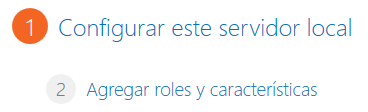
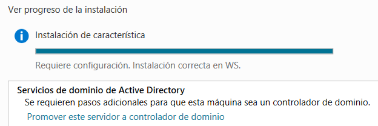
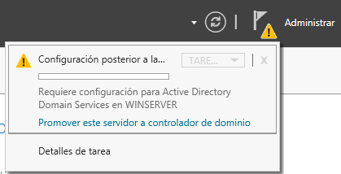

# Instal·lació d'un controlador de domini en Active Directory

## Configuració prèvia

**Configurar el nom del servidor**


**ATENCIÓ**: És molt important assegurar-se que el nom del servidor sigui el correcte abans de promocionar-lo a controlador de domini. Un cop configurat com a controlador de domini, no és recomanable canviar-ne el nom, ja que això pot provocar incongruències en les bases de dades d'Active Directory, els fitxers de configuració i els registres DNS.


## Rol, servei de rol i característiques

Un cop instal·lat **Windows Server**, és possible ampliar-ne les funcionalitats mitjançant la incorporació de **rols**, **serveis de rol** i **característiques**. Aquests components permeten adaptar el servidor a les necessitats de l'organització, proporcionant serveis de xarxa, eines d'administració i funcionalitats addicionals.

En aquest punt veurem en què es diferencien.

### Rol (Funció)

Un **rol** és un conjunt de programes que permeten a un servidor realitzar una funció específica per a usuaris o altres equips dins d'una xarxa.

Alguns exemples de rols són:

* Active Directory Domain Services (AD DS)
* DHCP Server
* DNS Server
* Hyper-V
* Remote Access
* File and Storage Services

### Serveis de Rol

Els **serveis de rol** són components que proporcionen la funcionalitat específica d'un rol. Segons la seva configuració, ofereixen determinats serveis als usuaris i ordinadors de la xarxa.

Alguns rols només disposen d'un únic servei i, per tant, no tenen serveis de rol addicionals configurables. Per exemple:

* DNS Server

En canvi, altres rols inclouen diversos serveis de rol que es poden instal·lar de manera independent. Per exemple, el rol **Remote Access** permet instal·lar **serveis de rol** com:

* DirectAccess i VPN (RAS)
* Routing
* Web Application Proxy

### Característiques (Features)

Les **característiques** són programes o components que no formen part directament d'un rol, però que poden:

* Ampliar la funcionalitat d'un o diversos rols.
* Millorar el funcionament general del servidor.
* Afegir eines d'administració o compatibilitat.

#### Exemple

La característica **Failover Clustering** augmenta la disponibilitat de serveis com:

* File Services
* DHCP Server

Permetent que diversos servidors treballin en clúster per:

* Augmentar la redundància.
* Millorar la disponibilitat dels serveis.
* Reduir el temps d'inactivitat davant d'errors.

#### Altres exemples de característiques

* Mòduls de PowerShell.
* Compatibilitat amb sistemes Linux.
* .NET Framework.
* Windows Server Backup.
* Failover Clustering
* BitLocker Drive Encryption

## Instal·lació del Directori Actiu

1.  La instal·lació del **Directori Actiu** és la implementació d'una funció bàsica o rol del nostre Windows Server. Com qualsevol altre rol de servidor el podem instal·lar des de l’_**Administrador del servidor**_ i seleccionar l'opció _**Agregar roles y características**_ que obrirà l'assistent per afegir funcions.

     
2.  Triem l'opció _**Instalación basada en características o en roles**_.

    <figure><figcaption></figcaption></figure>
3. Després d’algunes pantalles d'informació on cal escollir a quin servidor el volem instal·lar, anirem amb el botó de _**Següent**_ fins a la llista de possibles funcions per instal·lar en el sistema.
4.  Marcar l'opció _**Serveis de Domini d'Active Directory (AD DS)**_ i _**DNS Server**_ i prémer el botó de _**Següent**_.

    Donat que es fan servir noms de domini caldrà instal·lar i configurar al servidor el servei de DNS per tal que resolgui els noms de domini que es fan servir. Aquest servei s'instal·la per defecte si no el detecta.

    <figure><figcaption></figcaption></figure>
5.  Un cop finalitzada la instal·lació ens apareix una pantalla informativa on ens adverteix que per convertir el servidor en un controlador de domini funcional cal obrir l'assistent per crear un nou domini seleccionant _**Promover este servidor a controlador de dominio**_.

    

    <figure><figcaption></figcaption></figure>

## Promocionar el servidor a controlador de domini i creació del domini

Un cop instal·lats els serveis bàsics de **Directori Actiu** és necessari completar la instal·lació mitjançant la **promoció de l'equip a controlador de domini** i la creació d'un **nou domini** mitjançant els següents passos:

En l’_**Administrador del servidor**_ ens apareix una notificació indicant que es requereix una configuració de l'AD i mostra l’opció de _**Promover este servidor a controlador de dominio**_.

Després de la pantalla d'inici de l’assistent hi ha tres opcions:

* _**Afegir l'equip com a controlador de domini a un domini ja existent**_: serveix per afegir un controlador secundari o de «backup» a un domini ja creat. Això permetrà repartir la càrrega entre els dos servidors i, en cas què el controlador principal caigui, el sistema podrà continuar proporcionant el servei amb el controlador secundari.
* _**Afegir un nou domini en un bosc existent**_:
* _**Afegir un nou bosc**_.

Com es tracta de crear un domini aïllat (sense relació amb altres dominis, ni serà un subdomini, ni tampoc un controlador secundari dins del mateix domini...) escollim la tercera opció _**Afegir un nou bosc**_.

A continuació has d'introduir el nom complet del domini arrel. Aquest nom ha de complir l'estructura DNS (_Domain Name System_).

El domini no existirà realment a Internet, per tant, serà de tipus **.local**.

<figure><figcaption></figcaption></figure>

Després ens demana el nivell de funcionalitat del sistema. Sempre escollirem el més alt, tret que calgui garantir la compatibilitat amb altres dominis gestionats per versions inferior.

En el nostre cas, a **Nivell de funcionalitat** cal seleccionar l'opció _Windows Server 2025_ o bé _Windows Server Technical Preview_ si no has aplicat l'última actualització de Windows Server.

L'assistent ens demana ara una **contrasenya** per poder administrar el **Directori Actiu** en cas de necessitar accedir al mode de restauració. Això pot ser util quan s'ha de reparar l'Active Directory, restaurar una còpia o fer el mateniment de la base de dades d'AD.

Introdueix doncs la contrasenya i prem _**Següent**_.

<figure><figcaption></figcaption></figure>

A continuació indicarà que no troba un servidor DNS, però **no cal fer res**; automàticament s'instal·larà el servei de DNS en aquest mateix servidor perquè **cal tenir instal·lat el servei de resolució de noms per al correcte funcionament del Directori Actiu**.

La finestra següent, demanarà el **nom NetBIOS** del domini. Es pot deixar el què proposa per defecte, que serà el nom del domini en majúscules i sense .local.

Després s'ha d'indicar la localització dels arxius bàsics que utilitzarà el Directori Actiu: la carpeta per a base de dades, la carpeta d'arxius de registre i la carpeta SYSVOL que conté els arxius públics del domini que han de ser compartits. Podem deixar les opcions per defecte.

A continuació, se'ns informa mitjançant un **resum**, de totes les configuracions que hem seleccionat.

En prémer _**Següent**_ comença el procés de comprovació de requisits previs i després podem seleccionar _**Instal·lar**_ i comença el procés de **promoció de l'equip a Controlador de Domini**.

Un cop acabada la instal·lació es **reiniciarà l'equip** perquè el Directori Actiu s'iniciï i estigui operatiu.

> Si tot ha funcionat correctament, el nostre equip ja està convertit en un controlador de domini del Directori Actiu per gestionar de forma centralitzada els recursos de la xarxa.

Un cop reiniciat el sistema, en la **pantalla d'inici** de sessió, on demana l'usuari i contrasenya, ja es pot veure un canvi: el nom d'usuari és `ADXXX\Administrador`.

### Configuració del DNS

Els passos de configuració addicional del servei DNS son:

1. Accedir al gestor de DNS: _**Server Manager > Tools > DNS**_
2. Amb _botó dret_ sobre el servidor, accedir a les _**Propiedades**_ (_**Properties**_)
3. A la pestanya _**Avanzado**_ (_**Advanced**_), activem _**Habilitar limpieza automática de registros obsoletos**_ (_**Enable automatic scavenging of stale records**_). Aquesta opció eliminarà els registres antics de la zona DNS amb la periodicitat que indiquem.
4. S'apliquen els canvis i es tanca la finestra emergent.
5. Desplegar el _**Forward Lookup Zones**_**&#x20;(Zona de Busqueda Directa)**_._
6. Entra/selecciona el domini per a desplegar els registres a la part dreta de la finestra.
7. A l'arbre de l'estructura DNS (part esquerra), amb _botó dret_ sobre la zona de domini (_xxx.local_), accedir a les _**Propiedades**_ (_**Properties**_)
8. A la pestanya _**General,**_ accedir a _**Caducidad**_ (_**Aging**_) per poder configurar la caducitat/neteja.
9. S'activa _**Limpiar registros de recursos obsoletos**_ (_**Scavenge stale resource records**_). Així s'habilita l'eliminació de registres antics.
10. Confirmar clicant a _**OK**._

Per comprovar que el servidor DNS resolt correctament els noms de domini, es pot fer un _**ping**_ des de la terminal. Per exemple:

<code>ping xxx.local</code>


Recorda que a la configuració de la xarxa, s'ha de revisar que tinguem correctament una IP estàtica i com a DNS la mateixa IP principal del servidor.


## Despromocionar el domini

1. Si s'intenta desinstal·lar _**Servicios de dominio de Active Directory**_, s'arriba a un punt en què avisa que primer s'ha de degradar el controlador de domini, i posa un enllaç per fer-ho.
2. Si aquest és l'últim controlador de domini (de fet, és l'únic), cal marcar l'opció _**Último controlador de dominio en el dominio**_.
3. Avisarà que el servidor té altres rols relacionats, però s'ha de marcar _**Continuar con la eliminación**_ i seguir endavant.
4. Després també s'ha de marcar _**Quitar esta zona de DNS...**_ i _**Quitar particiones de aplicación**_.
5. I finalment clicar el botó _**Disminuir nivel**_.

Després de reiniciar, en l'inici de sessió, el nom d'usuari ja no inclou el nom del domini.

## Unir equips al domini

### Configurar la xarxa del client

Primer de tot, **canvia el nom** de la màquina client. Ha de ser `wcxxx` (`xxx` són les teves inicials del nom i cognoms).

A continuació, assigna IP Estàtica al client. El controlador de domini també dona servei DNS al client, per tant, al client, **cal posar com a servidor DNS principal la IP del servidor de domini**.

> **ATENCIÓ**: és important recordar que per unir un client a un domini, el primer que cal fer és configurar com a **DNS principal** l'adreça **IP del servidor DNS** del domini, que és també el controlador de domini.

Finalment, fes pings per a verificar que el client pot comunicar-se amb el servidor.

* ping a la ip del servidor
* ping a google.com
* ping al servidor del domini (`wsxxx.adxxx.local`)

### Unir el client al domini

1. Entreu a la màquina client i **afegiu-la al domini**, canviant el mode de grup de treball al mode de domini. Una forma d'arribar a la configuració és fer clic amb el botó secundari del ratolí sobre la icona d'inici de Windows i seleccionar _**Sistema > Información > Configuración avanzada**_ (_o també, **Dominio o grupo de trabajo**_) **> (secció&#x20;**_**Nombre del equipo**_**) Cambiar**_._ En versions anteriors la ruta pot ser la següent: _**Sistema > Cambiar configuración > Cambiar...**_
2. Cal seleccionar l'opció _**Dominio**_ i posar el nom del domini al qual voleu connectar-la (`adxxx.local`). El nom del domini també es pot posar en el format NetBIOS (`ADXXX`).
3. Si pot connectar amb el servidor, demanarà les credencials de l'administrador del domini.
4. Si tot ha anat bé, ens indicarà que l'equip s'ha unit al domini, però que **cal reiniciar**.
5. Ara entreu a la màquina client i veureu que podeu entrar al domini mitjançant les credencials de l'administrador o d'un usuari estàndard. L'inici de sessió amb l'usuari de domini es pot fer, tal com s'indica a la [teoria](usuaris-grups-i-unitats-organitzatives.md#usuaris-globals), posant:
   * Format DNS: `nomusuari@adxxx.local`
   * Format NetBIOS: `ADXXX\nomusuri`

Si tot s'ha fet correctament, en accedir al client:

* A la pantalla d'inici de sessió del client, hauria d'apareixer l'opció per defecte de posar un usuari de domini.
* Al servidor, al programa _**Usuarios y equipos de Active Directory**_ ( _**Active Directory Users and Computers**_) o al _**Centro de administració de Active Directory**_ (_**Active Directory Administrative Center**_), a la UO anomenada _**Equipos**_ (_**Computers**_) hauria d'aparèixer el nou client.

### Desconnectar un client del domini

Si es vol desconnectar la màquina client del domini on estava connectada, cal tornar a l'apartat on hem anat per unir-la al domini, seleccionar l'opció _**Grupo de trabajo**_ i posar un nom (per defecte _**WORKGROUP**_).

Demanarà el nom i la contrasenya d'un usuari vàlid per realitzar aquesta acció i ens avisarà si s'ha produït algun error. Si tot ha anat correctament, **cal reiniciar** la màquina.

Si s'elimina el servidor DNS del domini, a la configuració de xarxa s'ha de treure el servidor DNS del domini i posar altres servidors DNS.

### Connectar el client a un altre domini

Un cop desconnectat el client del domini, cal posar com a servidor primari de DNS la IP del servidor DNS del nou domini.

Després repetirem els passos per unir el client a un domini posant el nom del nou domini.

### Connectar un domini a un bosc diferent

En algunes ocasions pot ser necessari unir un domini, un arbre o un bosc sencer a un altre bosc existent. Aquests casos es presenten quan s'uneixen dues empreses o s'havia fet configuracions totalment independents en el seu inici.

És imprescindible que els dos servidors tinguin connexió entre ells. De manera directa o indirecta han de poder veure's entre els seus serveis DNS. Això es configura:

* Opció 1: afegint la IP del DNS de l'altre servidor a la interfície de xarxa.
* Opció 2: afegint una regla al servei de DNS. _Tens un manual_ [_aquí_](https://somebooks.es/relaciones-de-confianza-con-dominios-de-otros-bosques-en-windows-server-2022-parte-2/).

Pots seguir els següents passos per unir un domini d'un bosc a un altre bosc: [https://somebooks.es/relaciones-de-confianza-con-dominios-de-otros-bosques-en-windows-server-2022-parte-3/](https://somebooks.es/relaciones-de-confianza-con-dominios-de-otros-bosques-en-windows-server-2022-parte-3/)

## Documentació i recursos

* **Controlador de domini**. Apunts de Pere Sánchez: [http://moodlecf.sapalomera.cat/apunts/smx/sox/index.html?tema=16](http://moodlecf.sapalomera.cat/apunts/smx/sox/index.html?tema=16)
* **Relaciones de confianza con dominios de otros bosques en Windows Server 2022.** De somebook.es: [Relaciones de confianza con dominios de otros bosques en Windows Server 2022 (Parte 1)](https://somebooks.es/relaciones-de-confianza-con-dominios-de-otros-bosques-en-windows-server-2022-parte-1/)
* Documentació de **Xavier Castejón Domenech**
