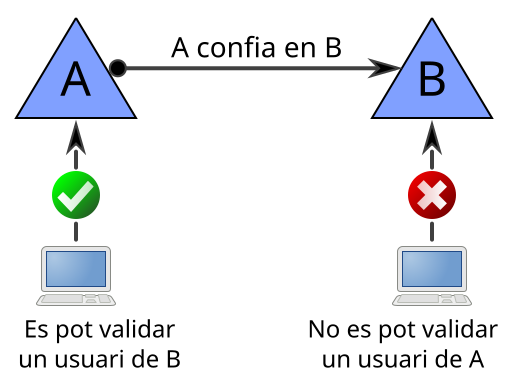
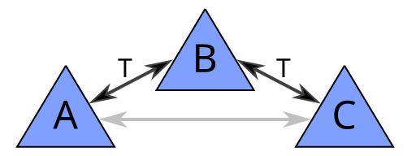
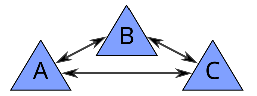

# Relacions de confiança

## Què són les relacions de confiança?

Els dominis poden compartir informació mitjançant **relacions de confiança**.

Les relacions de **confiança entre dominis** permeten:

* Que els usuaris d'un domini es puguin validar en un domini diferent del que pertanyen.
  * Per exemple, un alumne de l'institut Pla de l'Estany podria anar a l'institut Josep Brugulat i validar-se als ordinadors utilitzant el seu usuari.
* Que els usuaris d'un domini puguin accedir als recursos d'un altre domini.
* Gestionar els usuaris i recursos de diversos dominis de forma centralitzada.

## Tipus de relacions de confiança

### Relacions unidireccionals i bidireccionals

* **Unidireccional d'entrada en el domini A**: des de màquines unides al domini B es poden autenticar usuaris del domini A. S'acostuma a dir què el domini B confia en el domini A.
* **Unidireccional de sortida en el domini A**: des de màquines unides al domini A es poden autenticar usuaris del domini B. S'acostuma a dir què el domini A confia en el domini B.
* **Bidireccional**: des de màquines unides a qualsevol dels dos dominis es poden autenticar usuaris de l'altre domini. A confia en B i B confia en A.

**Exemple de relació unidireccional:** Unidireccional de sortida en el domini A i d'entrada en el domini B:

Vol dir que el domini A confia en el domini B, però B no confia en A. Els usuaris del domini B es poden validar en màquines unides al domini A, però els usuaris del domini A no es poden validar en màquines unides al domini B.

### Transitives i no transitives

* **Transitives:** si hi ha una relació transitiva entre els dominis A i B, i una altra entre els dominis B i C, implícitament hi ha una relació entre els dominis A i C.

En Windows, les relacions transitives també es diuen relacions de bosc, perquè quan s'afegeix un subdomini o un arbre a un bosc existent, es crea automàticament una relació transitiva.

* **No transitives:** si hi ha una relació no transitiva entre els dominis A i B, i una altra entre els dominis B i C, si es vol que hi hagi una relació entre els dominis A i C caldrà crear una relació explícita entre ells.

## Documentació i recursos

* **Sistemas Operativos en Red.** De somebooks.es: [Capítulo 10: Relaciones entre dominios](https://somebooks.es/capitulo-7-relaciones-entre-dominios/)
* **Relaciones de confianza con dominios de otros bosques en Windows Server 2022.** De somebooks.es: [Relaciones de confianza con dominios de otros bosques en Windows Server 2022 (Parte 1)](https://somebooks.es/relaciones-de-confianza-con-dominios-de-otros-bosques-en-windows-server-2022-parte-1/)
* **Relaciones de confianza con dominios de otros bosques en Windows Server 2022 (Parte 2).** De somebooks.es: [Relaciones de confianza con dominios de otros bosques en Windows Server 2022 (Parte 2)](https://somebooks.es/relaciones-de-confianza-con-dominios-de-otros-bosques-en-windows-server-2022-parte-2/)
* **Relaciones de confianza con dominios de otros bosques en Windows Server 2022 (Parte 3).** De somebooks.es: [Relaciones de confianza con dominios de otros bosques en Windows Server 2022 (Parte 3)](https://somebooks.es/relaciones-de-confianza-con-dominios-de-otros-bosques-en-windows-server-2022-parte-3/)
* **Funcionamiento de las relaciones de confianza en bosques de Active Directory.** Microsoft Learn: [Conceptos. Confianzas de bosques.](https://learn.microsoft.com/es-es/entra/identity/domain-services/concepts-forest-trust)
