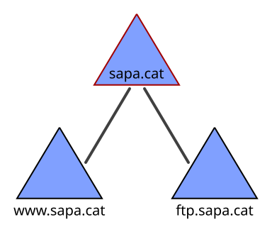
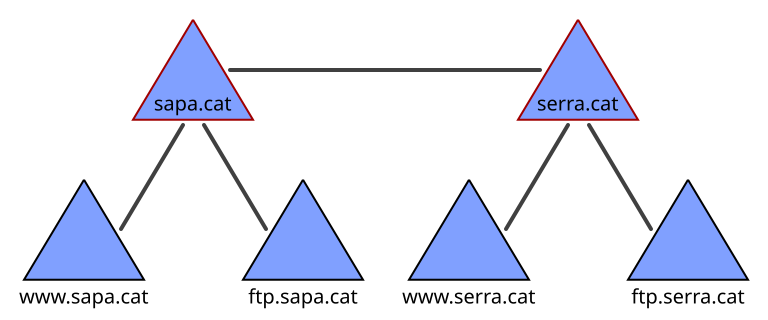
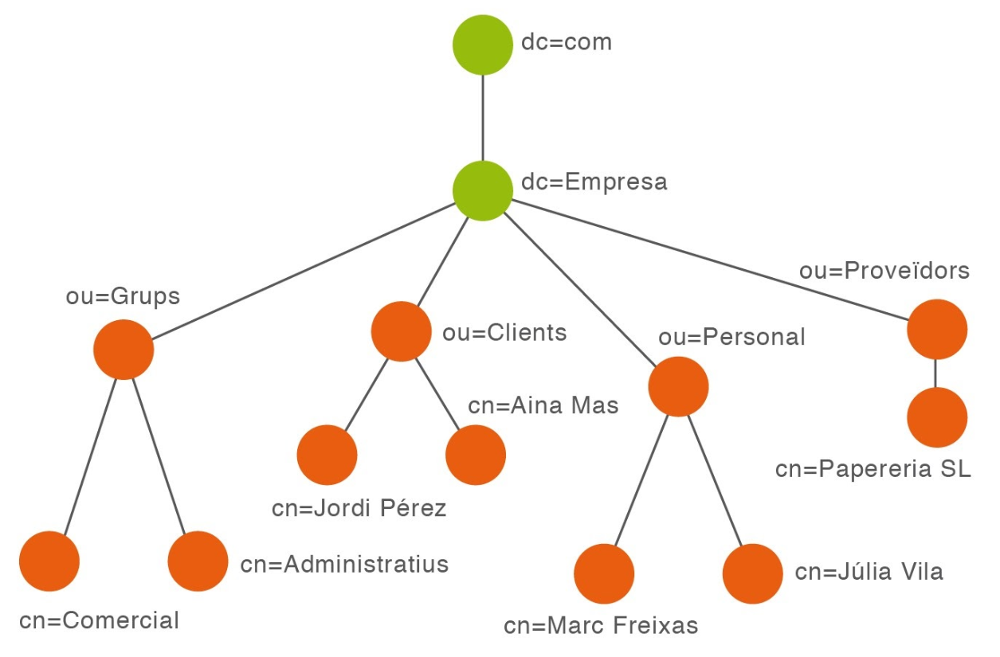

# Introducció als dominis

L’agrupació d'equips informàtics en xarxes té com a objectiu l'intercanvi d'informació i la **compartició de recursos**.

Es pot gestionar de dues formes:

* **Grups de treball (Workgroup)**&#x20;
* **Dominis**&#x20;

## Grups de treball

Els **grups de treball** són la forma més simple de compartir recursos entre diferents equips d'una xarxa petita.

En els grups de treball, tots els equips tenen el mateix nivell d'importància. Cada usuari administra els recursos del seu propi equip, decidint la política d'accessos, la seguretat i els recursos que vol compartir.

Els grups de treball tenen importants **limitacions**:

* La seguretat i gestió dels recursos no està **centralitzada**.
* Els **comptes d'usuari** són locals i només els podem utilitzar en l'ordinador on s'han creat.

A causa d'aquestes limitacions, en la majoria de les situacions, s'optarà per sistemes basats en **dominis**.

## Dominis

Amb un augment de la mida de la xarxa, la complexitat de l'administració es fa necessari la gestió centralitzada i l'administració basada en **dominis**.

> Un **Domini** és un conjunt d’equips connectats entre ells que comparteixen informació administrativa (usuaris, grups, contrasenyes...) centralitzada, una política de seguretat i una base de dades comú.

Tot domini tindrà un **controlador de domini** que administra els recursos i la seguretat del domini de forma centralitzada.

## Controlador de domini i clients

Quan instal·lem servei de directori en un equip de la nostra xarxa, convertim aquest equip en servidors de domini, els anomenats **controladors de domini \[**_**Domain Controlers**_**]**.

Cada domini ha de tenir **com a mínim un controlador de domini principal**, però pot tenir més d'un per dues raons:

* seguretat (les dades estan replicades)
* rendiment (es pot repartir la càrrega entre els diferents servidors)

La resta d’equips de la xarxa actuen com a **clients** d’aquest servei de directori i reben tota la informació guardada als controladors de domini (compte d’usuari, grups...).

Un **controlador de domini** és una part essencial dels sistemes operatius de Microsoft.

* S’encarrega fonamentalment d’emmagatzemar les parelles usuari-contrasenya dels comptes d’usuari que tenen accés al domini de xarxa.&#x20;
* Aquest controlador centralitza la funció d’autenticar l’accés al domini.

## Directori Actiu \[_Active Directory (AD)_]

> Els l'àmbit dels sistemes operatius en xarxa el concepte de **Directori** fa referència a un magatzem de dades estructurat que emmagatzema la informació sobre els diferents objectes de la xarxa (equip, usuaris, recursos compartits, etc).
>
> El **servei de directori** és el sistema que proporciona mètodes per emmagatzemar i recuperar les dades del directori.

El **Directori Actiu \[**_**Active Directory (AD)**_**]** és servei de directori implementat en les xarxes de la família Microsoft Windows Server.

El **AD** emmagatzema la informació necessària de la xarxa:

* Comptes d'usuari, grups i perfils d’usuaris.
* Equips i impressores
* Directives de seguretat, recursos, aplicacions, etc.

El **AD** permet accés i autentificació dels usuaris i control d'accés als recursos compartits.

El **AD** és l'eina que permet organitzar, controlar i administrar de forma centralitzada l'accés als recursos de la xarxa.

Quan instal·lem el **Directori Actiu \[**_**Active Directory**_**]** convertim aquest equip **controladors de domini**.

## Noms de domini

L'**Active Directory (AD)** es basa en el servei de noms de domini (**DNS**).

**DNS** és un servei de xarxa que tradueix els noms dels dominis a adreces IP.

L'**Active Directory (AD)** utilitza el servei de noms de domini (**DNS**), que caldrà instal·lar en el servidor, per resoldre el nom de la màquina per la seva adreça IP.

Mitjançant el DNS un equip que es connecta en xarxa pot trobar el **controlador de domini** _**\[Domain Controller (DC)]**_.

* A les màquines client posarem la IP del servidor com a servidor DNS a la configuració de la xarxa.

Cada **domini** de Windows Server queda identificat unívocament per un nom DNS. Per exemple:

`plaestany.local`

Cada **equip** que forma part d’un domini tindrà la categoria de subdomini i tindrà un nom DNS amb sufix el nom DNS del domini. Per exemple:

`equip1.plaestany.local`

## Estructura lògica. Domini, Arbre, Bosc

L’estructura del servei de directori està constituïda per diferents elements:

* **Objecte**: Entitats en el directori (usuaris, ordinadors, encaminadors, impressores...).
* **Domini (**_**Domain**_**)**: És l'element central i consisteix bàsicament en un conjunt d'objectes identificats per un nom de tipus DNS (Domain Name System).
* **Arbre**: És un conjunt de dominis que s’estructuren jeràrquicament i comparteixen recursos, clients i un sistema de resolució de noms.

La següent imatge representa un arbre que conté un domini principal (sapa.cat) i subdominis (www.sapa.cat, ftp.sapa.cat).

* **Bosc (**_**Forest**_**)**: Si el conjunt de dominis no comparteixen un nom d’arrel comú, s’anomena bosc. Per tant, un bosc és un conjunt d’arbres de domini.

## Objectes d'Active Directory

Els objectes d'Active Directory, i en conseqüència de LDAP, són els components bàsics d’una estructura lògica. Un usuari, una carpeta compartida, una impressora, un equip, etc.

Aquest objectes a part d'unes característiques predefinides pel protocol LDAP, a més del nom i localització, poden incorporar certa informació definida per l'usuari administrador. Tota aquesta informació s'anomena **atributs** i defineixen la informació-propietats d’un objecte.

#### Tipus d'objectes

Els diversos tipus d'objectes que podem utilitzar al crear la nostra estructura a LDAP i Active Directory són:

* **Domini (dc):** L’objecte arrel del domini.&#x20;
* **Unitat Organitzativa (ou):** contenidor jeràrquic d’objectes.&#x20;
* **Usuari (u, cn,...):** Representa un usuari de la xarxa i funciona com un magatzem d'informació de&#x20;
* identificació i autenticació&#x20;
* **Equip:** Representa un equip de la xarxa i proporciona el compte de màquina necessària perquè el sistema entreu en el domini .&#x20;
* **Contacte:** usuari extern al domini&#x20;
* **Grup (cn):** poden contenir objectes de diferents unitats organitzatives i dominis&#x20;
* **Carpeta compartida:** Proporciona accés de xarxa en AD a una carpeta compartida en un sistema Windows.&#x20;
* **Impressora compartida:** Proporciona accés de xarxa en AD a una impressora compartida en un sistema Windows.&#x20;
* **Contenidor:** una OU al que no se l’hi pot aplicar directives. &#x20;

## **Entrades**

Tot objecte ha de poder ser referenciat dins l'estructura d'un domini, arbre o bosc de manera inequívoca. Per poder-ho fer, els tipus d'objectes s'identifiquen amb una etiqueta clau com són _**ou**_ per les unitats organitzatives, _**dc**_ pel nom del domini, o _**cn**_ pels usuaris.

Com passa amb els fitxers i directoris en un sistema operatiu, es poden indicar el lloc on es guarden a través indicant la serva ruta relativa (relativa al lloc on ens trobem - _directori1/fitxer.txt_) o bé indicant la seva ruta absoluta (tenint en compte l'arrel del disc _c:/directori0/directori1/fitxer.txt_). A LDAP tenim el **RDN** (o referència relativa) i el **DN** (Nom Distingit).&#x20;

#### Què és un RDN? &#x20;

Noms de Referència Relativa. És la part del nom d’un objecte. És el fragment de DN anterior al primer OU. Distingeix l’objecte dins de l’OU pare. &#x20;

_**CN=Ned Stark**,OU=People,DC=gamesofthrones,DC=north._&#x20;

#### Què és un DN? &#x20;

És nom simbòlic que identifica l’objecte de manera inequívoca dins del domini, utilitzat la ruta completa de l’arbre.&#x20;

_**CN=Ned Stark,OU=People,DC=gamesofthrones,DC=north**_&#x20;

#### En què es diferencien?&#x20;

* GUID i DN distingeixen inequívocament un objecte dins del domini. El primer, però, és inalterable tot fent canvis de localització dins de l’arbre.&#x20;
* RDN distingeix l’objecte només dins del contenidor OU pare.&#x20;

#### Exemple

* **Base →** “dc=Empresa,dc=com”
* **DN d'un dels clients →** "cn=Aina Mas,ou=Clients,dc=Empresa,dc=com”
* **RDN de la persona dins la OU=Clients→** "cn=Aina Mas"&#x20;

## Documentació i recursos

* **Introducció als dominis**. Apunts de Pere Sánchez: [http://moodlecf.sapalomera.cat/apunts/smx/sox/index.html?cap=0.1.12](http://moodlecf.sapalomera.cat/apunts/smx/sox/index.html?cap=0.1.12)
