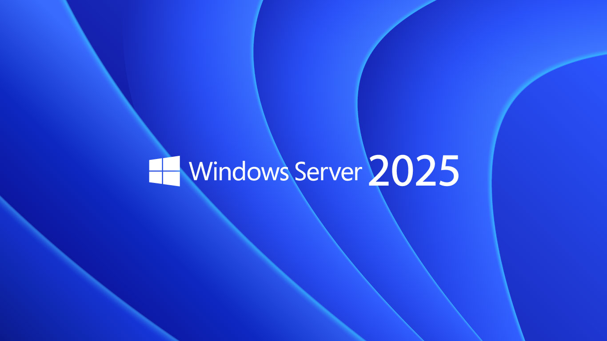

# Windows Server

Windows Server és una distribució de Microsoft per a l’ús de servidors.

Està desenvolupat en el llenguatge de programació C++ i Assembler.

Es tracta d'un sistema multiprocés i multiusuari que actualment utilitzen milions
\
d'empreses de tot el món gràcies a les característiques i avantatges que ofereix.

Treballa sobre un model denominat **domini**.

Un **domini** és un conjunt d’equips (clients i servidors) que comparteixen una política de seguretat i una base de dades comú.

Cada domini té un nom únic.

El **controlador de domini** és una part essencial dels sistemes operatius de Microsoft. S’encarrega fonamentalment d’emmagatzemar les parelles usuari-contrasenya dels comptes d’usuari que tenen accés al domini de xarxa.

Aquest controlador centralitza la funció d’autenticar l’accés al domini

## Microsoft Windows Server 2025

Actualment, la versió més recent és la **Microsoft Windows Server 2025** llançada comercialment l'any 2025. La versió anterior era el **Microsoft Windows Server 2022**.

Els trets diferenciadors que cal destacar en aquest sistema operatiu són els següents:

* **Utilització d’una tècnica modular**.&#x20;
  * Dissenyat de manera independent els components del sistema operatiu.&#x20;
  * Permet eliminar o instal·lar components nous amb facilitat.
* **Control de comptes d’usuari**.&#x20;
  * Les aplicacions s'executaran sempre sota els privilegis d’un compte d’usuari.&#x20;
  * El control de comptes d’usuari (UAC, user account control) millora la seguretat de l'equip.

Cal tenir present que una màquina gestionada amb el Microsoft Server:

* No pot ni hivernar ni entrar en mode suspès. Així i tot, tècnicament es pot configurar, però no és recomanable ni habitual.
* No es pot restaurar com les versions personals. Sí que es poden fer servir còpies de seguretat i altres sistemes més professionals.
* Té limitacions pel que fa a l’estalvi energètic. Els servidors prioritzen rendiment i disponibilitat per sobre de l’estalvi energètic.

## Windows Server Edicions

El sistema Windows Server es distribueix empaquetat en diferents **Edicions**.

Aquestes edicions s'han anat redefinint, creant i eliminant segons les versions. Cada una presenta unes limitacions definides per diversos entorns de treball.

És possible que la majoria de les característiques d'una edició siguin adequades per un entorn, però que alguna limitació impedeixi fer-la servir tal com es necessitaria o es voldria.

### Windows Server 2022&#x20;

Amb **Windows Server 2022** es redueixen el nombre d'edicions respecte al Windows Server 2019, eliminant l'edició _**Essential**_ amb suport d'instal·lació independent i retirant les edicions especials _**Hyper-V Server**_, _**Storage Server**_ i _**MultiPoint Services** (rol eliminat)_.

Les edicions de Windows Server 2002 són:

* **Standard Edition**
  * Per a petites/mitjanes empreses.
  * Usuaris/Dispositius determinats per llicències ([CAL](https://www.microsoft.com/es-es/licensing/product-licensing/client-access-license?msockid=3c64675af76261212b0e73b7f6bf60bc#tab-cal-y-ml)).
  * Limitacions en virtualització (màxim 2 màquines virtuals).
* **Datacenter Edition**
  * Per datacenters amb alta virtualització.
  * Usuaris/Dispositius determinats per llicències ([CAL](https://www.microsoft.com/es-es/licensing/product-licensing/client-access-license?msockid=3c64675af76261212b0e73b7f6bf60bc#tab-cal-y-ml)).
  * Sense limitació d'instàncies virtuals + una màquina en Hyper-V.
* **Datacenter: Azure Edition**
  * Per empreses amb infraestructura Azure.
  * Usuaris/Dispositius determinats per llicències ([CAL](https://www.microsoft.com/es-es/licensing/product-licensing/client-access-license?msockid=3c64675af76261212b0e73b7f6bf60bc#tab-cal-y-ml)).
  * Sense limitació d'instàncies virtuals + una màquina en Hyper-V.

En el cas de **Windows Server 2025**, es pot trobar informació de les versions i els preus a: [https://www.microsoft.com/es-es/cloud-platform/windows-server-pricing](https://www.microsoft.com/es-es/cloud-platform/windows-server-pricing)

Una edició especial és:

* **Essentials Edition**
  * Només a través de llicència (es fa servir l'Standard per activar-la).
  * Per a petites empreses.
  * Servidors amb 1 processador (màxim 10 nuclis).&#x20;
  * Limitat a 25 usuaris i 50 dispositius.
  * Llicència per 1 sola màquina física o virtual.
  * Sense Hyper-V.

.png>)

#### _**Windows Server Nano**_

Aquesta és una versió ultralleugera de Windows Server dissenyada per ser implantada en contenidors i entorns amb recursos limitats. No instal·lable en una màquina física.

Es poden fer servir per:

* Entorns d'aplicacions .NET
* Aplicacions lleugeres
* Components lleugers del servei web (IIS)

## Documentació i recursos

* **SomeBooks.es: Ediciones de Windows Server 2022:** [https://somebooks.es/windows-server-2022-ediciones-y-licencias/](https://somebooks.es/windows-server-2022-ediciones-y-licencias/)
