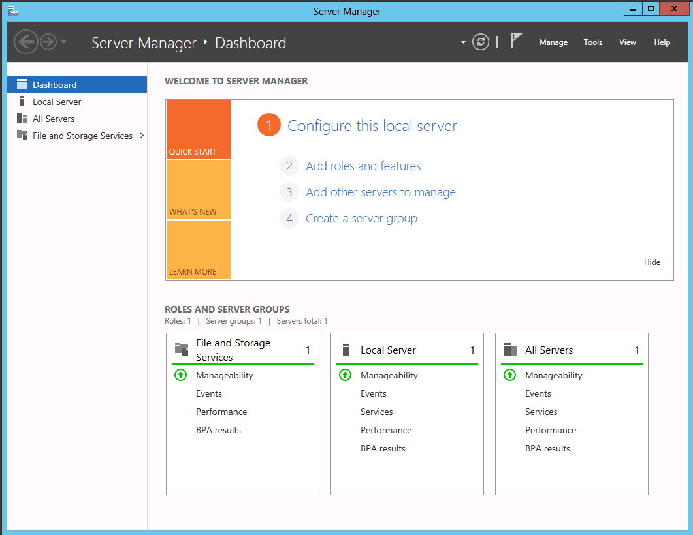
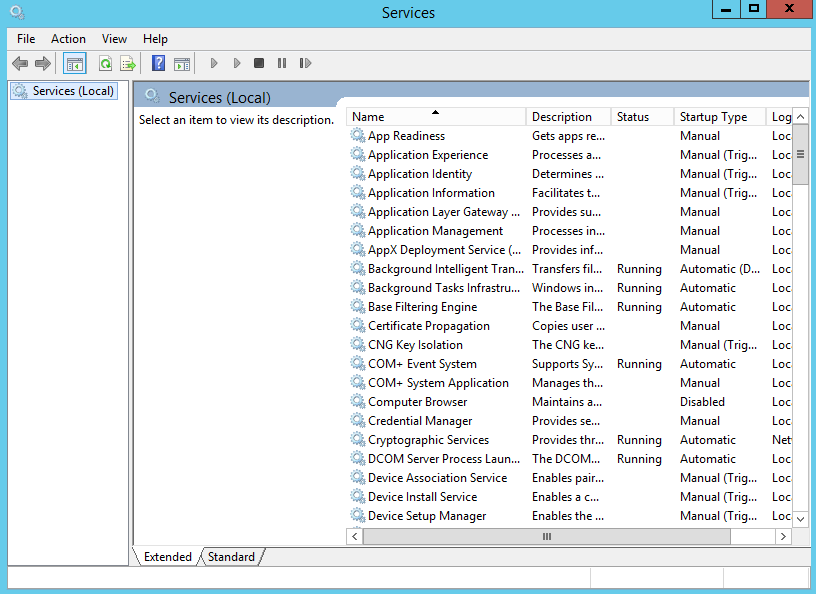
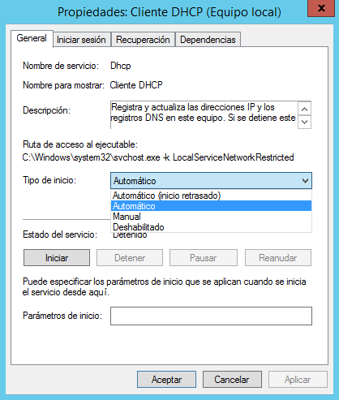
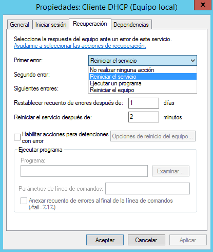
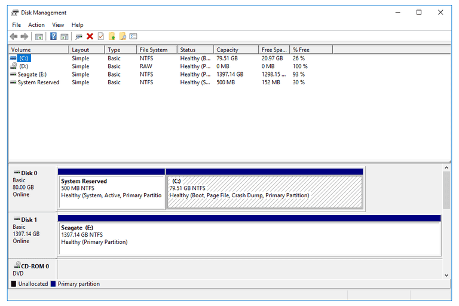
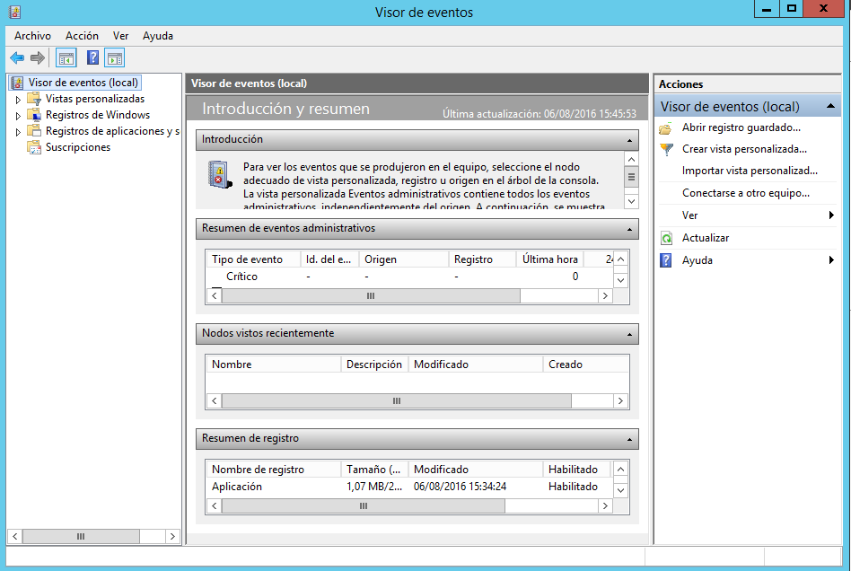
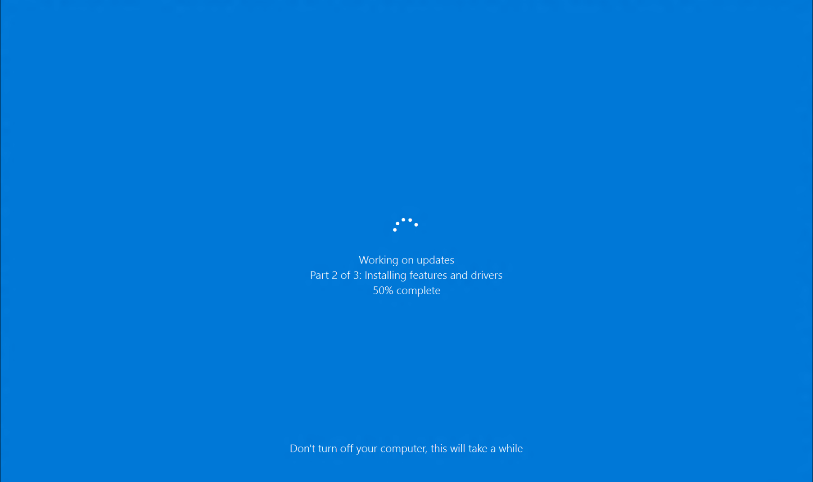
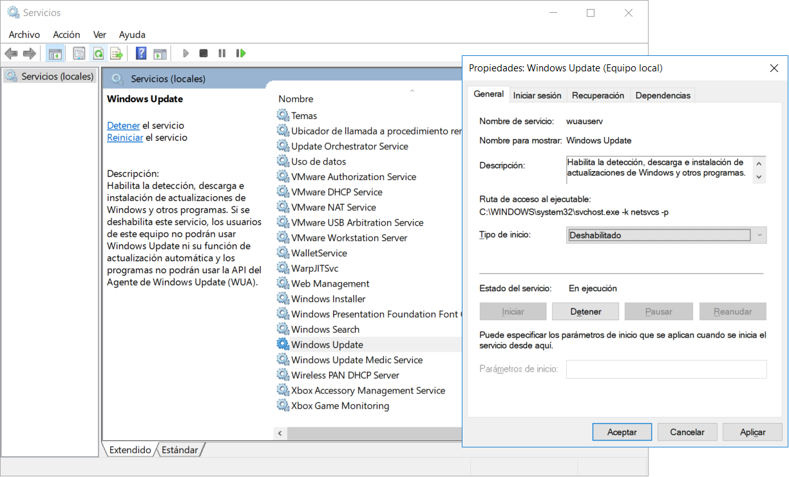
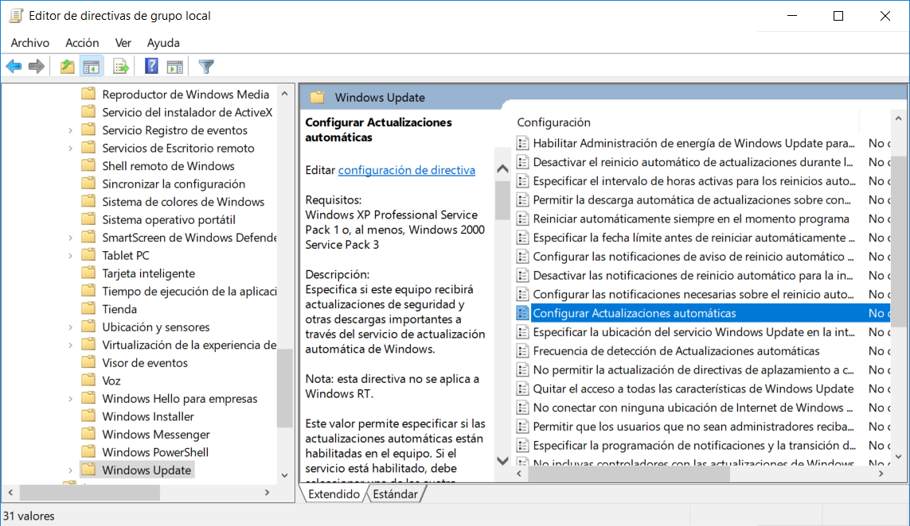

# Supervisió en Windows Server

## Tasques de l’administrador de sistemes

Algunes de **tasques d'un administrador de sistemes** d'informació:

* Instal·lació, configuració i reconfiguració del Sistema Operatiu
* Instal·lació, actualització dels drivers i firmwares.
* Instal·lació de les **actualitzacions** crítiques i/o recomanables del sistema operatiu tan directament relacionades amb el rendiment, disseny, funcionament i la seguretat.
  * Crítiques és important instal·lar-les, sempre que no afecti el funcionament del sistema d'informació.
  * Recomanables dependrà de si ens soluciona un problema o no.
* Gestió i comprovació de les **còpies de seguretat**.
* Planificació del manteniment del sistema.
* **Monitoratge i vigilància:**
  * esdeveniments de seguretat, registres i alertes
  * l’estat del sistema comprovant el rendiment de l'equip
  * l’estat de la xarxa
  * l’estat dels serveis
  * l’espai físic d’emmagatzematge
  * els possibles problemes generats pel programari
  * etc

***

## Eines de supervisió

El sistema operatiu Microsoft Windows Server us proporciona una sèrie d’**eines** per poder **administrar el sistema** de manera efectiva i ràpida:

* **Administrador del servidor**
* **Windows Admin Center**
* **Administració de tasques**
* **Administració de serveis**
* **Administrador de discs**
* **Registre d’esdeveniments**
* **Monitor de recursos**
* **Monitor de rendiment**
* **Programador de tasques \[Task Scheduler]**

Algunes d'aquestes eines i d'altres que no estàn lligades a la supervisió, es poden accedir a través de l'**Administració d'Ordinadors** \[Computer Management], accessible amb l'execució de `compmgmt.msc` o amb "_Botó dret sobre logo de Windows" > Administració d'Ordinadors._

<figure><figcaption></figcaption></figure>

### Administrador del servidor _\[Server Manager]_

L'**Administrador del servidor** permet veure, en una única pantalla, la informació del sistema, opcions de configuració de seguretat i els seus possibles problemes de configuració.



L'**Administrador del servidor**, amb una única eina, permet als administradors:

* Veure i modificar els **rols i característiques instal·lats** al servidor.
* Realitzar tasques d'administració com **iniciar o aturar serveis** i administrar comptes d'usuari locals.
* Determinar l'**estat del servidor**.
* Identificar **esdeveniments crítics**.
* Analitzar i solucionar **problemes o errors de configuració**.

### Windows Admin Center

**Windows Admin Center** fa uns anys que ha estat creat per substituir, sobretot, el _Server Manager_ i així integrar la capacitat de diverses aplicacions "clàssiques" en un&#x61;_._

<figure><figcaption></figcaption></figure>

És una aplicació web formada per quatre grans mòduls:

* Administrador del servidor
* Clústers de commutació per error
* Clústers hiperconvergits (HCI)
* Clients Windows

És un administrador pensat per la gestió d'una infraestructura local. Es poden administrar servidors, clients i clústers.

En les últimes versions s'han creat directa amb el cloud de Microsoft, **Azure**. Aquesta és una connexió natural en l'evolució de l'administració de grans infraestructures. Tot i així, no substitueix l'aplicació web d'administració d'Azure, ni és el seu principal objectiu.

Les característiques principals es podries resumir en:

* _**Gestió centralitzada via navegador**_: el que li permet molta més lleugeresa de resursos que no pas el seu predecessor _Server Manager_.
* _**Administració remota i segura**_**:** Accés mitjançant HTTPS, amb autenticació i rols d’usuari.
* _**Sense dependència d'internet**_**:** és per la gestió local, tot i que es pot integrar amb la infraestructura que l'empresa tingui a l'Azure.
* _**Fàcil instal·lació**_**:** Es pot instal·lar a un Windows client o un Windows Server i accedir a ell des d'un navegador web.
* _**Integració amb Azure (opcional)**_**:** Permet l'accés a eines d'Azure, tot i que la gestió principal es realitza a l'Azure Portal (administrador dels serveis d'Azure).

### Administrador de tasques _\[Task Manager]_

L’**administrador de tasques** és l’eina principal per administrar processos i aplicacions del sistema.

Disposa de cinc pestanyes. Aquestes pestanyes us ajudaran a administrar **processos, rendiment, usuaris i serveis**.

* **Processos** _**\[Processes]**_: aplicacions d'usuari i processos que s'estan executant en segon pla (processos del sistema), i la utilització que estan fent del sistema (CPU i memòria)
* **Detalls** _**\[Details]**_: programes associats a les aplicacions. Permet canviar la prioritat de cada un
* **Usuaris** _**\[Users]**_: quins usuaris estan connectats i quines aplicacions estan utilitzant; també es poden desconnectar usuaris.
* **Serveis** _**\[Services]**_: quins serveis estan engegats o aturats. Permet aturar o iniciar serveis. També es pot obrir l'administrador de serveis per gestionar els serveis de forma més detallada.
* **Rendimient** _**\[Performance]**_: veure la utilització global de la CPU, la memòria i la xarxa. Des d'aquest apartat es pot obrir el Monitor de recursos, que permet veure amb més detall la utilització de la CPU, la memòria, la xarxa i els discos.
* **Historial d'aplicacions \[**_**App History**_**]**: permet veure l’ús acumulat de CPU i xarxa de les aplicacions modernes (UWP), pensada sobretot per a control i monitoratge de les apps d’aquest tipus.

<figure><figcaption></figcaption></figure>

Tenim **quatre vies per accedir** a l’administrador de tasques:

* Combinar les tecles _**Control, Majúscules i Esc**_.
* Combinar les tecles **Control, Alt i Supr** i escollir l’opció Iniciar l’administrador de tasques.
* Clicar a Inicio, escriure _**taskmgr**_ en el quadre de text, clicar a Iniciar la cerca i prémer Enter.
* Clicar amb el botó dret del ratolí a la barra d’eines i seleccionar l’opció _**Administrador de tasques**_.

### Administrador de serveis _\[Services]_

> Els **serveis** són programes que funcionen sense interactuar directament amb l'usuari.

Normalment són programes que s'arranquen amb el sistema operatiu.

L'eina _**Serveis**_ mostra l'estat dels serveis i permet gestionar-los.

Cada servei el podem configurar: Ens posem a sobre > boto dret ratolí > propietats:



#### Configuració d'inici d'un servei

És important que feu la **configuració d’inici** dels serveis més escaient.

> Que un servei estigui instal·lat no vol dir que s'estigui executant.



Existeixen quatre **tipus d’arrencada d’un servei**:

* **Automàtic:** El servei que s’iniciarà quan l’equip s’engegui.
* **Automàtic (inici retardat):** el servei s’inicia quan l’equip està en marxa i tots els serveis automàtics (marcats amb l’opció anterior) estan funcionant.
* **Manual:** el servei s’haurà d’iniciar manualment.
* **Deshabilitat:** el servei estarà desactivat i no es pot engegar.

> Tenir executant-se serveis que no fem servir consumirà recursos innecessaris.

#### Configuració de la recuperació d'un servei

El sistema Microsoft Windows Server permet fer accions si detecta que un servei específic falla.



Existeixen tres opcions de **recuperació d’un servei**:

* **No fer cap acció:** el sistema no intentarà recuperar-se d’aquest error, però sí de la resta.
* **Reiniciar el servei:** atura el servei, fa una pausa i el torna a iniciar.
* **Executar un programa:** si es produeix un error en aquest servei, es llançarà un script o un programa.

### Administrador de discs _\[Disk Management]_

L'**administrador de discs** permet administrar els discs, particions i volums.



### Registre d’esdeveniments _\[Event Viewer]_

El **registre d’esdeveniments** mostra a l’administrador informació sobre els error o avisos que s'han produït al sistema.

Els principals són:

* Registres de Windows
  * Aplicacions
  * Seguretat
  * Instal·lació
  * Sistema
* Registres d'aplicacions i serveis
  * Esdeveniments de hardware



Aquesta eina proporciona moltíssima informació. Per trobar de forma ràpida la que es necessita, es poden crear vistes personalitzades o filtrar els que compleixin uns determinats criteris.

També ofereix la possibilitat de guardar determinats esdeveniments i esborrar-los per evitar que el registre creixi indefinidament.

### Monitor de recursos \[_Resource Monitor_]

El Monitor de recursos (Resource Monitor) és una eina disponibles als servidors i edicions professionals de Windows que permet observar en temps real com el sistema operatiu i les aplicacions utilitzen els recursos principals de l’ordinador o servidor.

És un complement de l'_**Administrador de tasques**_ i del _**Monitor de rendiment**_, que ofereix una visió molt més detallada.

<figure><figcaption></figcaption></figure>

Podem accedir a la informació detallada d'ús de CPU, Memòria principal (RAM), Discs i Xarxa. É suna versió més detallada, però amb un disseny menys actualitzat que l'_**Administrador de tasques**_.

Podem accedir a aquesta aplicació amb la comanda: _resmon.exe_

### Monitor de rendiment \[_Performance Monitor_]

Per poder comprovar si el rendiment d'un equip és correcte, primer de tot cal recollir un conjunt de dades just després de la instal·lació per poder-les comparar amb dades recollides posteriorment. Aquestes dades inicials es diuen _**Línia base**_.

Les principals dades que cal utilitzar són:

* La utilització dels processadors.
* La utilització de la memòria RAM i de la memòria virtual.
* El treball dels discos (lectura i escriptura).
* La utilització de la xarxa respecte de l'amplada de banda.

El **Monitor de rendiment** \[Performance Monitor] és una que permet mesurar i analitzar el rendiment del sistema operatiu i les aplicacions al detall.

Pot usar aquesta eina per al següent:

* Analitzar els efectes de rendiment que tenen les aplicacions i els serveis en un equip.
* Obtenir informació general sobre el rendiment del sistema.
* Recopilar informació detallada per solucionar problemes.

<figure><figcaption></figcaption></figure>

Les eines o característiques principals què inclou el Monitor de rendiment són:

1. Eines de supervisió: Proporciona una presentació visual de comptadors de rendiment integrats de Windows, ja sigui en temps real o com a dades històriques.
   * _**Comptadors de rendiment (Performance Counters)**_**:** permeten mesurar l'estat o l'activitat del sistema. Es poden afegir de múltiples fonts: sistema operatiu, serveis, aplicacions i rols de Windows. Aquest comptadors es poden establir tenint en compte diferents mètriques (p. ex. % d’ús de CPU, bytes llegits del disc/segon, memòria disponible). Aquest compadors es poden associar a alertes i accions a realitzar.
   * _**Gràfics en temps real**_: proporciona una visió gràfica de l'evolució de diferents comptadors, què permeten comparar recursos i detectar anomàlies.
2. Data Collector Sets (Conjunts de recopiladors de dades): és un conjunt personalitzat de comptadors de rendiment, seguiments d' esdeveniments i dades de configuració del sistema què fa un registre de dades durant un període determinat. És una eina idea per fer auditories de rendiment o analitzar incidències.
3. Informes: Són la representació estructurada de les dades recopilades pels comptadors de rendiment, conjunts de recopilació de dades (Data Collector Sets) o altres eines de monitoratge.

La comanda per poder accedir és _perfmon.exe_

_**Com afegir un nou comptador?**_

<figure><figcaption></figcaption></figure>

### Programador de tasques \[_Task Scheduler_]

El programador de tasques, no és estrictament una eina de supervisió, sinó una eina d'automatització. Això vol dir, que ens permet executar tasques programades. Aquestes poden ser _scripts_ fets amb PowerShell o Batch.

**Què podem fer?**

* **Programar execucions** d’aplicacions o scripts (per exemple, obrir un programa cada dia a una hora concreta).
* **Llançar tasques en funció d’esdeveniments** (quan l’usuari inicia sessió, quan s’encén l’ordinador, quan es connecta a la xarxa, etc.).
* **Automatitzar tasques de manteniment** com netejar fitxers temporals, fer còpies de seguretat o actualitzacions.
* **Configurar condicions i accions**, com establir que una tasca només s’executi si l’ordinador està connectat a la corrent elèctrica o si té accés a la xarxa.

#### Com funciona?

Les **tasques** tenen tres parts principals:

1. **Desencadenador (trigger):** quan s’ha d’executar la tasca.
2. **Acció (action):** què ha de fer (executar un programa, enviar un missatge, etc.).
3. **Condicions (conditions):** en quines circumstàncies es pot executar.

**Per exemple...**

Es pot apagar o reiniciar el sistema de forma periòdica (per exemple, els diumenges a les 3h de la matinada) o només un cop (el dia 31 de desembre). Això es pot fer introduint directament la comanda o fent que s'executi un script amb aquesta comanda i moltes altres.

1. Directament amb Powershell seria: `schtasks /create /sc daily /tn "AturarSistema" /tr "shutdown /s /f /t 0" /st 03:00`
2. Fent servir el programador de tasques, es podria:
   1. Indicar l'hora d'execució i la comanda a executar: `shutdown /s /f /t 0`
   2. Indicar l'hora d'execució i el fitxer .bat o ps que es vol executar. En aquest exemple, una aturada (shutdown /s) forçada (/f) amb un temps d'espera de 0 segons (/t 0):


```batch
@echo off
shutdown /s /f /t 0
```


***

## Emmagatzematge

La gestió d'emmagatzematge és un de les tasques de supervisió més rellevants, però que alhora, més s'ha modificat amb el temps. Amb l'arribada dels SSD, les tasques d'òptimització per evitar la fragmentació s'han reduït ostensiblement. La velocitat dels SSD i la seva matriu d'emmagatzematge fa que no sigui tant rellevant com amb discs durs (HDD).

Existeixen diverses eines integrades per realitzar la gestió de l'emmagatzematge. Veiem algunes.

### Administració de discos \[Disk Management]

Ens permet realitzar les següents tasques de gestió i supervisió:

* Crear, eliminar i redimensionar particions
* Assignar lletres d’unitat
* Formatejar discos
* Veure l’estat dels discos físics i volums

Poder accedir-hi executant `diskmgmt.msc`, cercant-lo al menú d'inici, o fent "_Botó dret sobre el botó d'inici" > Admnistració de discos._

### Optimitzar unitats

Aquesta eina analiza períodicament revisant el nivell de fragmentació. Quan existeix, reordena els fragments dels fitxers per òptimitzar l'accés als discos.

Es poden configurar la periodicitat de les revisions i també, fer-ne de manuals.

<figure><figcaption></figcaption></figure>

Es pot accedir a aquesta eina cercant-la, accedint directament a través del disc a revisar fent"_Botó dret sobre la unitat_" > _Propietats > Eines_, o a través d'"Emmagatzematge" de Configuració.

### Emmagatzematge (dins de Configuració)

**Emmagatzematge** cada vegada proporciona més informació i eines, algunes noves, d'altres que substitueixen a les "clàssiques" i també accessos directes a les que encara sobrevien i son difícils de subsitituir (encara).

Aquesta eina dins de la _Configuració_ de Windows, proporciona una vista visual de la distribució de l'emmagatzemantge del disc principal. Un aspecte molt semblant al que podem trobar a sistemes operatius mòbils.

Podem accedir seguint els següents passos: _Configuració_ > _Sistema > Emmagatzematge._

Entre d'altres, ens proporciona la següent informació i eines:

* **Visualització de la distribució de l'emmagatzemantge de disc** en tipus de fitxers i espais. A través dels menús podem accedir a qualsevol disc connectat.
* **Sensor d’emmagatzematge (Storage Sense):** Eina que neteja periòdicament l'emmagatzemantge fent tasques com eliminació fitxers temporals, gestió de fitxers de OneDrive o, buidant la _Paperera de reciclatge_.
* **Recomanacions de neteja:** Ens aporta recomenacions sobre la neteja i administració dels espais de discos.
* **Configuració avançada d'emmagatzematge:** Podem trovar opcions com:
  * Gestió d'altres unitats
  * Definició d'ubicació de fitxers nous (documents, música, videos...)
  * Còpies de seguretat.
  * Optimització de la unitat (defragmentació)
  * Gestió d’espais d’emmagatzematge (Storage Spaces)
  * Accés a informació avançada dels discos i volums

<figure><figcaption></figcaption></figure>

***

## Actualitzacions

Una de les tasques que ha de fer l'administrador de sistemes és assegurar-se que els sistemes operatius s'**actualitzen** correctament.

En **Windows Server**, la configuració predeterminada per entorns no gestionats estableix que les actualitzacions es _**descarreguen i s'instal·len automàticament**_, amb reinicis programats si cal.

Els administradors/es poden modificar aquest comportament mitjançant:

* Polítiques de grup (GPO)
* Configuració del servei Windows Update.
* Posant en pausa temporal des del menú de configuració del Windows Update.

### En Windows Server

En el **Windows Update** podem configurar:


* **Canviar hores actives:** Un cop instal·lades actualitzacions, si és necessari reiniciar, tenim dues opcions:
  * reiniciar el servidor manualment
  *   esperar un reinici automàtic fora de les hores de major activitat del sistema.

      De forma predeterminada, les hores de major activitat estan definides entre les 8:00 i las 17:00. Si aquests valors no s'adapten a l'horari de la teva empresa els podem modificar amb l'opció _**Cambiar horas activas**_.
* **Opcions de reinici** Quan es programa un reinici automàtic després d'instal·lar actualitzacions, amb aquesta opció podrem canviar l'hora i el dia en el qual es realitzarà el reinici.
* **Opcions avançades**
  * **Ofrecer actualizaciones para otros productos de Microsoft cuando actualice Windows**. Permet mantenir actualitzades la resta d'aplicacions que hàgim adquirit de Microsoft al mateix temps que actualitzem el sistema operatiu.
  * **Aplazar actualizaciones de características**. Permet deixar d'instal·lar aplicacions del sistema operatiu que no tinguin a veure amb la seguretat. Això redueix els temps necessaris en instal·lar actualitzacions, però deixes de disposar de les últimes funcions que s'incorporin al sistema operatiu.

### Cas d'exemple: Impedir actualitzacions a Windows

Amb l'arribada de **Windows 10** el servei d'actualitzacions va fer un canvi significatiu de paradigma. Es va pensar més en els usuaris inexperts que no pas en els professionals. S'ha volgut evitar que per manca de coneixement o d'atenció, es deixi d'actualitzar el sistema amb el gran risc de seguretat que pot comportar.

Per això, quan un pedaç de seguretat crític és emès pels servidors d'actualització de Microsoft, el servei d'actualització el descarregarà, l'**instal·larà i reiniciarà el sistema automàticament** si és necessari o es **reservarà la instal·lació en fred per la següent vegada de aturem o reiniciem manualment el sistema**.

Tot això ho farà sense demanar consentiment a l'usuari i, si ens descuidem, ens reiniciarà el sistema sense tenir en compte el que estiguem fent en aquell moment.



En el nostre cas una actualització forçada ens podria destorbar durant la realització d'alguna pràctica o control. Per això, farem servir algunes eines administratives per impedir-ho.

#### A) Deshabilitar el servei d'actualitzacions

El servei responsable de les actualitzacions de Windows s'anomena _**wuausrv**_ però en l'_Administrador de serveis_ el podrem trobar com _**Windows Update**_. A partir d'aquí només haurem de deshabilitar el servei.

_**Administrador de serveis > "Windows Update" > Propietats > Tipus d'inici > Escollir Deshabilitat**_ _**Administrador de serveis > "Windows Update" > Propietats > Estat del servei > Detenir**_



#### B) Deshabilitar la directiva de grup (GPO) responsable de les actualitzacions

La _**Directiva de grup (GPO)**_ és un conjunt de regles de Windows que ens permeten gestionar i configurar el sistema operatiu, les aplicacions i els usuaris. I això ho podrà fer de manera local o en un domini i, distingint-los entre regles vinculades a usuaris i a equips. Però aquest és un tema que tractarem àmpliament més endavant. El que ens interessa saber ara mateix és com utilitzar una de les directives responsables de les actualitzacions automàtiques.

Accedim a l'editor de directives. Tres opcions:

* _\[Win + R]_ -> Escriu "gpedit.msc" per executar-lo
* _"Botó dret sobre Inici de Windows" > Executar_
* _\[Clica sobre el botó d'inici -> Escriu "Editar directiva de grupo"_

Dins de l'editor seguirem la següent ruta:

_**Configuració de l'equip > Plantilles administratives > Components de Windows > Windows Update**_

A la dreta, trobarem un llarg llistat de regles. Entre elles, **deshabilitarem** almenys una de les següents regles:

* _Configurar Actualitzacions automàtiques_
* _No reiniciar automàticament amb usuaris que hagin iniciat sessions en instal·lacions d'actualitzacions automàtiques_



Per forçar l'aplicació de directives editades haurem d'executar \[Win + R]: `gpupdate /force /boot /logoff`

## Documentació i recursos

SomeBooks.es: [Configurar las actualizaciones en Windows Server 2022 con GUI](https://somebooks.es/configurar-las-actualizaciones-en-windows-server-2022-con-gui/)

SomeBooks.es: [Instalar actualizaciones en Windows Server 2022 con GUI](https://somebooks.es/instalar-actualizaciones-en-windows-server-2022-con-gui/)

Learn de Microsoft: [Supervisión del rendimiento de Windows Server](https://learn.microsoft.com/es-es/training/modules/monitor-windows-server-performance/)

Learn de Microsoft: [Descripción de los registros de eventos de Windows Server](https://learn.microsoft.com/es-es/training/modules/manage-monitor-event-logs/2-describe-windows-server-event-logs)

Learn de Microsoft: [Storage settings in Windows](https://support.microsoft.com/en-us/windows/storage-settings-in-windows-5bc98443-0711-8038-4621-6a18ddc904f2)
