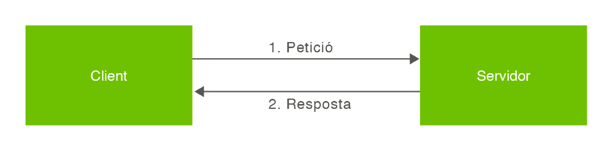
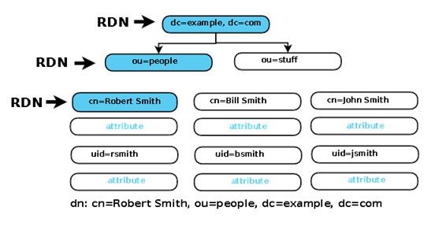

# Funcionament de LDAP

## Estructura client-servidor

És un **model client-servidor**, això vol dir que davant d’una consulta concreta d’un client, el servidor contesta amb la informació sol·licitada. La resposta pot ser, a més de la informació que se sol·licita:
<br>

* un punter que indica on aconseguir aquesta informació
* dades addicionals (habitualment, el punter apunta a un altre servidor de directori).

<figure><figcaption><p>LDAP com a servei local</p></figcaption></figure>

<figure><figcaption><p>LDAP com a servei remot</p></figcaption></figure>

### Procés de negociació

1. El client LDAP envia una sol·licitud al servidor LDAP amb un codi identificatiu.
2. El servidor executa una o diverses operacions (segons el que s’especifiqui a la sol·licitud).
3.  Resposta:

    * Si la transmissió correcta → el servidor envia els resultats.
    * Si hi ha un error → s’envia al client el codi d’error corresponent.


## Components de la informació

A l’LDAP la informació està estructurada en forma d’arbre. Aquest arbre s’anomena Arbre d’Informació del Directori o DIT (Directory Information Tree).

Sovint reflecteix diversos arbres:

* Polítics
* Geogràfics
* Límits d’organitzacions

Per tant, l’arbre dependrà del model escollit i la de quantitat de jerarquització que hi vulguem aplicar.&#x20;

### El model de noms

El model de noms de LDAP defineix com són identificades i organitzades les entrades dins de l'estructura de l’arbre.

Poden aparèixer entrades que representin:

* People
* Organizational units
* Printers
* Documents
* Groups of people&#x20;
* … qualsevol cosa que representi una entrada de l’arbre (o múltiples entrades)

#### Components bàsics del model de noms

**Entrades**

* És la unitat bàsica d’informació dins del directori
* Una col·lecció d’informació sobre un objecte.

```
<tipus_atribut>=<valor>[,<tipus_atribut>=<valor>]
```

**DN – Distinguished Name**

* És un nom únic que identifica una entrada manera inequívoca.
* Pot canviar si es mou l’entrada dins de l’arbre. &#x20;
* Són creats amb el nom de l’element RDN i afegint-hi el nom sencer del pare.

**RDN – Relative Distinguished Names**&#x20;

* Cada RDN dins una DN correspon a una branca del DIT.
* Cada RDN és un conjunt d’Atributs.
* Cada atribut és un nom i un valor.
* Cada part del RDN ha de ser un atribut i valor presents a l’entrada.

**UUID**

* Identifica de manera inequívoca una entrada tot i que es mogui dins de l’estructura.&#x20;

**Atribut**

* Descriu un tret particular de l'objecte
* Una entrada es compon d’un conjunt d’atributs
* Cada atribut es compon de:&#x20;
  * El tipus d’informació continguda
  * Valor que conté

<figure><figcaption></figcaption></figure>

### Atribut

La identificació unívoca d’una entrada depèn de la utilització correcta de parells de valors i claus

El conjunt de claus (atributs) que es fa servir normalment són les següents:

* **uid (userid):** és un identificador únic per a cada usuari.
* **cn (common name):** és el nom d’usuari.
* **givenname:** és el nom de la persona.
* **sn (surname):** és el cognom de la persona.
* **o (organitzation):** és l’organització o companyia a la qual pertany aquesta persona.
* **ou (organizational unit):** és el departament de l’organització o companyia on treballa aquesta persona.
* **mail:** és l’adreça de correu electrònic personal.

<figure><figcaption></figcaption></figure>

## La informació a LDAP

El directori és la BBDD de LDAP. Té una **estructura jerarquitzada**, en forma d'**arbre**. Hi ha un **node arrel**, i a partir d'aquí l'estructura  s'organitza en **subarbres**.

Cada node de l'arbre, és  un  objecte  LDAP i poden o no contenir altres objectes.

<figure><figcaption></figcaption></figure>

_**Un exemple:**_

* Base → _“dc=Empresa,dc=com”_
* DN de la persona → _“uid=mfreixas,ou=Persones,dc=Empresa,dc=com”_

<figure><figcaption></figcaption></figure>

Cada **objecte** de l'arbre ve definit per un esquema que defineix les seves **característiques**.

Els  objectes  poden  heretar  característiques  d'altres objectes   o   proporcionar   característiques   a   altres objectes.

L'esquema  defineix  els  parells  d'**atributs-valors**  que pot tenir un objecte, i unes normes bàsiques referents als atributs indicant si és obligatori o opcional.

<figure><figcaption></figcaption></figure>

## **Estructura**

### Implementació

Els components bàsics de la implementació **OpenLDAP** són els següents:

1. El **servidor slapd** (_stand-alone LDAP daemon_): un dimoni que escolta per defecte pel port **389** per peticions de connexió **LDAP**, també pot fer-ho pel **636** per **LDAPS** (LDAP sobre TLS).
2. Les **llibreries de client LDAP**: llibreries que implementen el protocol LDAP i que poden ser utilitzades per desenvolupar programari de client amb accés al protocol LDAP. Exemples externs són els serveis del sistema com PAM, NSS, aplicacions web... Permeten implementar clients LDAP en diversos llenguatges (C, Python, Java, etc.).
3. Les _**utilitats, eines i diversos clients**_ de mostra. Exemples típics: `ldapsearch`, `ldapadd`, `ldapmodify`, `ldapdelete`, `ldapwhoami`...

### Arquitectura

L’arquitectura del servidor està dividida en:

* Una  secció  de  processament  frontal  (**frontend**),  que controla  les  connexions  de  xarxa  i  el  processament del protocol.&#x20;
* Una  secció  de  processament  dorsal  o  de  segon  pla (**backend**), que s’encarrega de l’emmagatzematge i la recuperació de les dades en resposta a les peticions que es reben. L'exemple més habitual és el **mdb**

<figure><figcaption><p>Client-Servidor LDAP</p></figcaption></figure>

Pel que fa a seguretat existeix es pot implementar amb:

* **TLS/SSL**, què permet xifrar la comunicació entre clients i servidor LDAP. Exemples: LDAPS i SartTLS.
* **SASL** (_Simple Authentication and Security Layer_), el qual proporciona **mecanismes d’autenticació avançada**. No xifra per si sol, necessita TLS. Com a gran avantatge, permet integrar LDAP amb Kerberos i sistemes d'autenticació centralitzada.
*   Control d’accés (**ACLs**). És un mecanisme bàsic per garantir la **confidencialitat i integritat** de les dades. Mitjançant regles ordenades defineix **qui pot accedir a què** dins del directori. La seva simplicitat recau en el fet que s'aplicarà la primera regla que coincideixi.

    Per exemple, controla:

    * Lectura
    * Escriptura
    * Autenticació
    * Accés per atribut, entrada o branca

### Distinguished Name

Cada node de l’arbre s’anomena entrada. Una entrada és una col·lecció d’atributs identificada per un **nom distintiu** (**DN -&#x20;**_**Distinguished Name**_). Aquest DN és únic al directori i fa referència a l’entrada de manera unívoca.

Estructura de DN:

```
<tipus_atribut>=<valor>[,<tipus_atribut>=<valor>]
```

Exemple:

```bash
uid=mfreixas,ou=Persones,dc=Empresa,dc=com
```

<figure><figcaption></figcaption></figure>

Després de crear l'esquema podrem afegir el **backend** i **frontend** del nostre servidor de directori.
\
Per configurar aquesta informació s'haurà de realitzar un fitxer amb les línies desitjades.&#x20;

### LDIF

LDIF (_**Lightweight Data Interchange Format**_) és un format d’intercanvi de dades que permet exportar i importar dades des d’un directori o cap a aquest fent servir un fitxer de text simple.&#x20;

La sintaxi d’aquest format és la següent:

```
1 [<id>]
2 	dn: <nom distingit>
3 	<attribut>: <valor>
4 	<attribut>: <valor>
5 ...
```

Per exemple:


```bash
dn: cn=John Doe,dc=example,dc=com
cn: John Doe
givenName: John
sn: Doe
telephoneNumber: +1 888 555 6789
telephoneNumber: +1 888 555 1232
mail: john@example.com
manager: cn=Barbara Doe,dc=example,dc=com
objectClass: inetOrgPerson
objectClass: organizationalPerson
objectClass: person
objectClass: top
```


On:

* **dn:** és el nom distingit de l’entrada (nom complet, com si fos un directori absolut si parléssim de fitxers). No és cap atribut ni forma part de l’entrada.
* **cn=John Doe**: és l’entrada RDN (**nom relatiu distingit**’).
* **dc=example, dc=com**: són els noms distingits de l’entrada pare, on _**dc**_ significa ‘component de domini’ (domain component).
* La resta de línies són atributs en aquesta entrada, que habitualment fan servir cadenes mnemotècniques: “_**cn**_” per ‘nom comú’, “_**dc**_” per ‘component de domini’, “_**mail**_” per ‘correu electrònic’ i “_**sn**_” per ‘cognom’.

Cal tenir en compte que:

* Cada nova entrada ha d’estar separada de l’anterior mitjançant una **línia buida**.
* Es pot definir un atribut que ocupi diverses línies sempre que a partir de la segona línia es comenci amb un **espai en blanc o una tabulació**.
* Es poden definir diversos valors per un atribut repetint la cadena de caràcters _**nom: valor**_ en línies separades.

#### Exemple complet de fitxer LDIF

Un exemple complet de fitxer **.ldif** amb la creació d'OU, grup i usuari seria el següent:


Aquest només és un exemple. No és el format obligatori, però sí un format estàndard



```bash
# Creació de la unitat organitzativa "usuaris"
dn: ou=usuaris,dc=smx2,dc=cat
objectClass: organizationalUnit
ou: usuaris

# Creació de la unitat organitzativa "grups"
dn: ou=grups,dc=smx2,dc=cat
objectClass: organizationalUnit
ou: grups

# Creació del grup "alumnes" dins de la OU grups
dn: cn=alumnes,ou=grups,dc=smx2,dc=cat
objectClass: posixGroup
cn: alumnes
gidNumber: 5000

# Creació de l'usuari dins de la OU usuaris
dn: uid=oriolvinyals,ou=usuaris,dc=smx2,dc=cat
objectClass: inetOrgPerson
objectClass: posixAccount
objectClass: shadowAccount
uid: oriolvinyals
sn: Vinyals
givenName: Oriol
cn: Oriol Vinyals
displayName: Oriol Vinyals
uidNumber: 10000
gidNumber: 5000
userPassword: oriolvinyalsldap
gecos: Oriol Vinyals
loginShell: /bin/bash
homeDirectory: /home/vinyals_oriol
```


Observa que els grups i les OU s’han de crear abans que els objectes que s’hi vinculen. Per exemple, primer es crea l’**OU&#x20;**_**Grups**_ i, un cop creada, s’hi crea el **grup&#x20;**_**Alumnes**_ dins d’aquesta OU.
