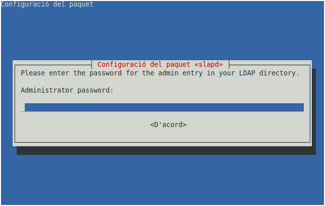

# Instal·lació d'un controlador de domini LDAP

## Configuració prèvia

Quan s'instal·la el servei de directori LDAP s'ha de:

* Verificar que el sistema operatiu té el nom de la màquina i l’FQDN correctament configurats.

<p align="center"><code>hostname</code></p>

<p align="center"><code>hostname -f</code></p>

En cas de no ser correctes amb els que volem configurar podrem editar `/etc/hostname` i /`etc/hosts`.<br>

* S'ha de tenir la xarxa correctament configurada amb una **IP fixa**.

## Instal·lació OpenLDAP

El programa OpenLDAP s'instal·la com a servei amb el paquet _**slapd**_.

```
  sudo apt update
  sudo apt install slapd
```

**slapd** (_Independent LDAP Daemon_) és un programa que s'executa en segon pla atenent les sol·licituds d'autenticació LDAP que es rebin al servidor. Aquest servei escolta peticions al **port 389/TCP**.

Durant la instal·lació, només us demana que introduïu una **contrasenya de l’administrador** del servei LDAP.



## Configuració servidor LDAP

Un cop instal·lat **OpenLDAP** cal configurar-lo amb la comanda:

`sudo dpkg-reconfigure slapd`

1. La primera pantalla que es mostra, actua com a mesura de seguretat, per assegurar-se que no fem canvis per error. Cal anar amb compte perquè la pregunta es fa a l'inrevés, és a dir, ens pregunta si volem **ometre la configuració del servidor** haurem de triar l'opció **NO**.
2. El directori LDAP ha de tenir una arrel de la qual penja la resta d'elements. Com a **nom de l'arrel de domini** s'utilitza un nom DNS. En aquest tutorial es farà servir el domini _**ldapxxx.local**_ (En el teu cas, has d’utilitzar el teu domini).
3. **Nom de l'organització** en la qual estem instal·lant el directori LDAP: _**ldapxxx.local**_
4. Se us informarà sobre els possibles gestors de bases de dades per emmagatzemar el directori. Es recomana **MDB** - tot i que HDB encara funciona - perquè ens permetrà canviar els noms dels subarbres si calgués.
5. **Esborrar la base de dades anterior** del directori quan acabem la configuració de slapd: **SI**.
6. Com s’ha decidit esborrar la base de dades antiga, l'assistent ens pregunta si volem **canviar-la de lloc la base de dades antiga**: **NO**.
7. En algunes xarxes pot ser necessari mantenir la versió 2 del protocol LDAP. Pregunta si volem **permetre el protocol LDAPv2**. En el nostre cas **NO**.
8. La configuració s'ha realitzat amb èxit.

**Més informació**: [Instalación y configuración de OpenLDAP](http://www.ite.educacion.es/formacion/materiales/85/cd/linux/m6/instalacin_y_configuracin_de_openldap.html)

## Seguretat i TLS/SSL (opcional - _adequat per entorns oberts_)

La configuració LDAP per defecte transmet dades en text pla si no s’implementa TLS. La [documentació oficial](https://documentation.ubuntu.com/server/how-to/sssd/with-ldap/) recomana configurar **TLS** (així es converteix el servei en _LDAPS_) per protegir les credencials i evitar vulnerabilitats.


Al fer servir TLS, el servei passa a fer serviro el **port 636/TCP**


## Comprovar el servei LDAP

Una vegada configurat el servei, **ens assegurem que funciona** amb l’ordre següent:



El servei ha d'aparèixer actiu.

`sudo systemctl status slapd`



Verificar que el port 389 de TCP està obert:

`sudo nmap localhost`&#x20;

També podem filtrar directament el port. Algunes opcions son:

`nmap -p 389 localhost`

_ó_

`sudo netstat -tulnp | grep :389`

_ó_

`sudo ss -tulnp | grep :389`

Per comprovar que és accessible localment:

`nc -zv localhost 389`



Verifica el seu funcionament amb la comanda `slapcat` que permet veure la base de dades de l’OpenLDAP en format LDIF.

`sudo slapcat`



Per tal d’arrencar o reiniciar el servidor LDAP, executeu l’ordre següent:

`sudo systemctl restart slapd`                 &#x20;



Seguretat i TLS/SSL (opcional - _adequat per entorns oberts_)

Si es vol implantar el TLS/SSL, es pot seguir el segünet tutorial: [Ubuntu - "LDAP and Transport Layer Security (TLS)"](https://documentation.ubuntu.com/server/how-to/openldap/ldap-and-tls/)



## Reconfigurar el servidor LDAP

Si no hem configurat correctament el servei LDAP o volem canviar el nom del domini, es pot tornar a configurar el servei amb la comanda:

`sudo dpkg-reconfigure slapd`

## Instal·lació d'utilitzats d'administració de LDAP

També instal·larem el paquet _**ldap-utils**_ que proporciona algunes comandes per adminsitrar el serveidor, realitzar consultes i modificacions a la base de dades del servei LDAP.

Eines més importants:

* `ldapsearch` → cercar informació
* `ldapadd` → afegir entrades
* `ldapmodify` → modificar entrades
* `ldapdelete` → eliminar entrades

Com que aquest paquet es troba en els repositoris oficials d'Ubuntu, cal escriure la següent comanda:

`sudo apt install ldap-utils`

Per no haver d'indicar la base del domini i el servidor en cada comanda, es pot configurar l'arxiu `/etc/ldap/ldap.conf`:

* Descomentant les línies amb els paràmetres **BASE** i **URI**
*   I posant la base del domini i la IP del servidor LDAP (si hi hagués un servidor de DNS, també es podria utilitzar el nom DNS del servidor de LDAP, per exemple _**usxxx.ldapxxx.local**_):

    ```
    BASE   dc=ldapxxx,dc=local
    URI    ldap://IP_del_servidor
    ```

Per **comprovar amb ldap-utils que la configuració** del servei LDAP és correcta i veure els elements que hi ha a la base de dades LDAP es pot fer servir la següent comanda que mostra tots els _dn_ dels objectes del domini (de moment només el del domini i el de l'usuari _admin_):


En algunes versions i i[^1]nstal·lacions, es possible que l'usuari _admin._


```bash
usuari@usxxx:~$ ldapsearch -x -LLL dn
dn: dc=ldapxxx,dc=local

dn: cn=admin,dc=ldapxxx,dc=local
```

On:

* `-x`⁣: tipus d'autenticació amb el servidor LDAP
* `-LLL`⁣: mostra les dades sense comentaris, en versió 1 i sense mostrar la versió del document
* `dn`: Només mostrarà la línia del _distinguished name_ - dn de cada objecte.

També podem fer servir:

```bash
usuari@usxxx:~$ ldapsearch -x -b dc=ldapxxx,dc=local dn
dn: dc=ldapxxx,dc=local

dn: cn=admin,dc=ldapxxx,dc=local
```

Sense la configuració prèvia de l'arxiu `/etc/ldap/ldap.conf`, la comanda hauria de ser:

```bash
usuari@usxxx:~$ ldapsearch -x -LLL -H ldap://IP_del_servidor -b dc=ldapxxx,dc=local dn
dn: dc=ldapxxx,dc=local

dn: cn=admin,dc=ldapxxx,dc=local
```

També podem fer servir:

```bash
usuari@usxxx:~$ ldapsearch -x -H ldap://IP_del_servidor -b dc=ldapxxx,dc=local dn
dn: dc=ldapxxx,dc=local

dn: cn=admin,dc=ldapxxx,dc=local
```

Si mirem d'entendre la comanda, veure que podem obtenir la informació que necessitem de la nostra estructura LDAP.

L'estructura bàsica de la comanda és:

```
ldapsearch <previous_options> "(object_type)=(object_value)"
```

On:

* _\<previous\_options>_: són els arguments com&#x20;
  * `-x` : tipus d'autenticació amb el servidor LDAP)
  * `-LLL` : mostra les dades sense comentaris, en versió 1 i sense mostrar la versió del document)
  * `-H` : serveix per indicar l'URI del servidor (IP o nom, amb o sense port del servei) --> _ldap://_&#x49;P\_del\_servidor ó _ldap://servidorLDAP_ ó _ldap://_&#x49;P\_del\_servido&#x72;_:389_ ó   _ldap://servidorLDAP:389_
  * `-b` : és la base de cerca. Per exemple `dc=ldapxxx,dc=local` iniciaria la cerca des de l'arrel del domini i `ou=persones,dc=ldapxxx,dc=local` iniciaria la cerca des de la unitat organitzativa _persones_
* _(object\_type)=(object\_value)_ on:
  * object\_type: és el tipus d'objecte que es vol cercar com _objectClass, cn, uid, uidNumber,..._
  * object\_value: és el valor que cerquem, per exemple `objectClass=posixAccount` ens mostraria tot els usuaris, `uid: pau` mostraria la informació de l'usuari _pau_, i \* mostraria tots els objectes (exemple: `uid:*` --> tots els usuaris)

A la secció "[Exemples d'ús de ldap-utils](uf2-ldap-gestio-avansada.md#exemples-dus-dutilitats)" hi ha més exemples d'ús.

[^1]: 
