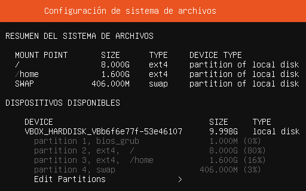

# Instal·lació de servidors GNU/Linux

## Planificació de la instal·lació

### Comprovar els requisits de maquinari

S'ha de comprovar a la web oficial, tant del sistema operatiu com de les aplicacions que s'han d'instal·lar, quins són els requisits de maquinari. La informació es troba a la web oficial de la distribució. No solen donar molta informació al respecte, però si t'introdueixes a la secció per Desenvolupadors i a les seves wikis, solen donar molta més informació.

Per descarregar Ubuntu: [https://ubuntu.com/download/server](https://ubuntu.com/download/server) i [https://ubuntu.com/download/desktop](https://ubuntu.com/download/desktop)

### Preparar el programari a instal·lar i les dades a configurar

S'ha de tenir preparat tot el programari i les dades necessàries: CDs, controladors, claus d'activació...

### Crear la màquina virtual

S'ha de crear una màquina virtual amb les característiques recomanades per instal·lar _**Ubuntu Server 64 bits**_:

* El nom de la màquina pot ser _**SOX Ubuntu Server**_ (un nom significatiu).
* Es recomana que l'espai del disc es reservi de forma dinàmica.
* Es pot posar més d'un processador.
* Connecta la MV a la més adequada. Revisa les opcions de [**xarxa a VirtualBox**](https://www.virtualbox.org/manual/ch06.html).

Després de la instal·lació, la memòria RAM es pot reduir, tot i que dependrà de l'ús que s'hagi de fer de la MV.

## Instal·lar el sistema operatiu

### Paràmetres bàsics de configuració

* Triar l'idioma i altres dades regionals (país, teclat...).
* **Nom de la màquina**: per exemple, _**usxxx**_ (_**xxx**_ són les teves inicials en minúscules).
* **Nom de l'usuari** (es pot posar nom i cognoms).
* **Nom del compte d'usuari** (una sola paraula, lletres minúscules o números...).
* **Contrasenya** (preferiblement que segueixi els criteris de seguretat).
* No cal encriptar la carpeta personal.
* Seleccionar la zona horària.

### Planificar el disc

Tot i que als sistemes Windows és important planificar els espais de disc, la seva gestió durant la instal·lació no arriba al nivell de personalització de Linux. A GNU/Linux podem crear **punts de muntatge** de directoris associats a una partició o disc.

A aquesta acció se l'anomena **muntar** una partició o disc.


Un **punt de muntatge** és qualsevol directori que s’utilitzi per accedir al sistema d’arxius de la partició. El que fa és afegir-lo a l'arbre de sistema d’arxius creat.\
Creant una partició amb punt de muntatge es reserva un espai de disc per aquell directori. Aquest va associat a un sistema de fitxers (ext4, ext5, swap...) com en qualsevol partició.\
Se solen fer per /, /boot, /home, i per l’espai d’intercanvi swap.


L'arbre de directoris genèric de GNU/Linux és el que es mostra a la imatge (s'ha de tenir en compte que la singularitat de cada distribució pot afegir nous directoris).

<figure><figcaption></figcaption></figure>

En el següent enllaç hi ha una descripció més profunda de cada directori: [https://en.wikipedia.org/wiki/Filesystem\_Hierarchy\_Standard](https://en.wikipedia.org/wiki/Filesystem_Hierarchy_Standard)

#### _Recomanacions en la planificació de disc_

Abans de començar a crear particions s'ha de tenir molt clar l'objectiu del dispositiu on instal·lem el sistema operatiu: client, servidor web, servidor de fitxers, servidor amb múltiples objectius... Aquestes decisions farà que sigui adequat fer punts de muntatge de directoris concrets i que li assignem uns espais concrets i necessaris.

Aquests són alguns dels punts a tenir en compte:

* Primer s'ha de seleccionar el particionat manual, triar el disc i crear la taula de particions.
  * En l'espai lliure, crear una partició nova amb prou espai per al nucli del sistema. Per exemple de 8 GB (tot i que s'ha de tenir en compte si es realitzaran més particions o no).
  * Crear-la com a partició primària, al principi del disc i amb el format _ext4_.
  * El punt de muntatge ha de ser l'arrel del sistema (/).
  * No cal afegir cap opció addicional de muntatge.
* Repetir els passos anteriors per crear una partició primària per la carpeta d'usuaris (/home). Aquest espai serà inferior al que es fa servir en un Ubuntu Desktop.
* Finalment, crear una altra partició primària amb la resta de l'espai per a la swap (àrea d'intercanvi). Tot i que és menys important actualment perquè disposem de més RAM, es pot posar la meitat de swap que de RAM. Si en tenim molt poca (< 2GB), podem optar per posar el mateix o, fins i tot, el doble (2GB - 4GB). Si deposem de gran quantitat de RAM, la mida podria de ser inferior a 1GB.
* Podem crear també una partició pel punt de muntatge /boot. Així si es corromp l'arrencada del sistema, es podria provar de reparar amb més facilitat.
* Es poden crear particions segons els requisits d'ús del servidor. Per exemple:
  * Per un servidor de propòsit general, podem crear també el /var i /tmp.
  * Per un servidor web es podrien crear també les particions /var/www, /var/log i /tmp.
  * Per un servidor de Bases de Dades, les /var/lib i /var/log.
  * Per un servidor de fitxers, serien adequats també /srv i /var/log.

#### _Configuració_

Cada distribució té el seu programa d'instal·lació. Així que ens haurem d'adaptar a cada tipus de configuració de particions.

Com indicar a Ubuntu Server que és el disc d'arrencada:

<figure><figcaption></figcaption></figure>

S'hauran de crear tots els punts de muntatge, indicant el sistema de fitxers associat. Recorda que el sistema de fitxers de swap és el _swap_.

Abans de confirmar, comprovar les particions creades (aquest només és un exemple):



Si ha quedat cap dubte respecte a aquesta part, pots visualitzar el [vídeo](https://drive.google.com/file/d/1Ld3dql1JlRSzpsu0m12A9G3ACHuJnFB3/view?usp=sharing) sobre gestió de particions d'una instal·lació manual d'Ubuntu Desktop.

### Altres paràmetres

* No cal activar les actualitzacions automàtiques.
* Instal·lar el servei **SSH** (seleccionar/deseleccionar serveis amb la tecla ESPAI).
* Instal·lar GRUB (el gestor d'arrencada) en el disc principal.

## Post-instal·lació

### Canviar el nom de l'equip

Si es vol canviar el nom d'una màquina Linux, cal fer-ho en els arxius `/etc/hostname` i `/etc/hosts` i reiniciar el sistema.

La revisió de la configuració del nom es podrà fer amb la comanda `hostname -f`. En els sistemes Debian també amb la comanda de `hostnamectl`, que mostra tota la informació del sistema, inclòs el nom de la màquina.

### Configurar la xarxa

Primer, amb la comanda `ip -a -4 -br address` cal comprovar quina és la targeta de xarxa que s'ha de configurar.

Antigament, s'utilitzaven els noms _**eth0**_, _**eth1**_... en funció de l'ordre en què es trobaven les interfícies.

Actualment, s'utilitza el sistema [Predictable Network Interface Names](https://www.freedesktop.org/wiki/Software/systemd/PredictableNetworkInterfaceNames/) que assigna sempre el mateix nom a una interfície de xarxa.

En aquest sistema els noms depenen, entre altres coses, del tipus i d'on està instal·lada (si és Ethernet o Wireless, si està integrada a la placa base, en un port PCI, en un port USB...).

* Interfícies **en**…: corresponen a targetes Ethernet (amb cable).
* Interfícies **wl**...: corresponen a targetes Wireless LAN (sense cable).
* Interfície **lo**: correspon a la interfície de **loopback**.

```bash
usuari@usxxx:~$ ip -br link
lo       UNKNOWN   00:00:00:00:00:00 <LOOPBACK,UP,LOWER_UP>
ens33   DOWN      d0:17:c2:97:22:69 <NO-CARRIER,BROADCAST,MULTICAST,UP>
wlp2s0   UP        00:13:f7:40:1c:a6 <BROADCAST,MULTICAST,UP,LOWER_UP>
```

Un servidor ha de tenir una **adreça estàtica**, ja que els clients l'han de conèixer per poder utilitzar els seus serveis.

L'adreça ha de pertànyer a la xarxa on està connectada la màquina.

**Cas 1: Una interfície amb IP estàtica.**

En _**Ubuntu Server**_, la xarxa es configura editant l'arxiu `/etc/netplan/01-netcfg.yaml`. Un exemple de configuració podria ser:

* **Adreça IP**: `172.16.241.230` (la IP que hagis de fer servir)
* **Màscara**: `255.255.0.0` (en aquest cas és de 16 bits, com la de la xarxa)
* **Porta d'enllaç (GW)**: `172.16.0.3` (l'adreça que correspongui al següent salt de la xarxa)
* **Servidors DNS**: `172.16.0.11` i `172.16.0.6` (els servidors DNS que corresponguin per la xarxa que farem servir)

```
network:
    version: 2
    renderer: networkd
    ethernets:
        ens33:
            addresses:
              - 172.16.241.230/16
            routes:
              - to: default
                via: 172.16.0.3
            nameservers:
                addresses: [172.16.0.11, 172.16.0.6]
```

Podem veure que el _gateway_ es configura com una ruta per defecte. Ja que aquest serà el salt per defecte si no es coneix el següent salt.

Així doncs, el paràmetre _**router**_ ens permet configurar les rutes disponibles des del dispositiu que s'està configurant.

**Comprovar** la nova configuració:

```
sudo netplan try
```

**Reiniciar la targeta** perquè agafi la nova configuració:

```
sudo netplan apply
```

**Cas 2: Dues interfícies, una amb connexió a internet i l'altra a xarxa LAN.**

Un cas clàssic en les pràctiques amb màquines virtuals és aconseguir que dues màquines, un servidor i un client, tinguin connexió entre elles i connexió a Internet. Si volem poder treballar a classe i a casa descarta l'ús de fer un _Bridge, ja que_ el servidor sempre ha de tenir a la xarxa interna una _IP estàtica_.

Aquesta és una configuració senzilla sense ús d'encaminament manual. Una interfície en NAT (ens33) i una en xarxa interna (ens38):

```
network:
    version: 2
    renderer: networkd
    ethernets:
        ens33:
            dhcp4: true
        ens38:
            addresses: [172.30.0.20/16]
```

I comprovem la configuració:

```
sudo netplan apply
```

### Comprovació de la xarxa

Les comandes que podem utilitzar per comprovar la configuració de xarxa són:

* `ip -4 -br addr` per comprovar la IP i la màscara de cada targeta de xarxa.
* `ip route` per veure la porta d'enllaç.
* `systemd-resolve --status` per veure quins servidors DNS es faran servir per resoldre noms de domini.

```
usuari@usxxx:~$ ip -4 -br address
lo       UNKNOWN   127.0.0.1/8 
ens33   UP        172.30.0.20/16
wlp2s0   UP        192.168.0.157/24 

usuari@usxxx:~$ ip route
default via 172.30.0.1 dev ens33 proto static
   ...

usuari@usxxx:~$ systemd-resolve --status
Global
   ...
Link 2 (ens33)
   ...
   DNS Servers: 172.30.0.1
```

Informació sobre la [configuració de la xarxa amb el netplan](https://documentation.ubuntu.com/server/explanation/networking/configuring-networks/index.html). Es pot veure configuració d'adreces estàtiques i a través de DHCP.

### Actualitzar el sistema

La comanda per actualitzar Linux és `apt-get upgrade`, però abans s'ha d'executar `apt-get update` per saber quins paquets cal actualitzar:

```
sudo apt-get update
sudo apt-get upgrade
```

En el cas d'_**Ubuntu Server**_, el nucli del sistema Linux no s'actualitza automàticament perquè cal reiniciar la màquina, i això és preferible que sigui l'administrador qui decideixi quan s'ha de fer.

Quan sigui possible actualitzar el nucli i reiniciar el servidor, es pot utilitzar la comanda `apt-get dist-upgrade`:

```
sudo apt-get update
sudo apt-get dist-upgrade
sudo reboot
```

Més informació al respecte als apunts [T4.8 Instal·lació i actualització del sistema GNU/Linux](https://docs.google.com/presentation/d/1XMAhAKIBlrQoqTeJUVHabJoc74cvL6oU820lFgFa4_Q/edit?usp=sharing)

### Muntatge de partició o disc

La majoria de sistemes d'instal·lació de distribucions permeten formatar els discos addicionals indicant el punt de muntatge. En alguns casos, també permet marcar que siguin muntats automàticament en l'inici del sistema.

Si no s'ha realitzat aquest procés durant la instal·lació o si s'afegeix un disc nou posteriorment, el muntatge es pot fer de dues maneres:

* Muntatge automàtic: Es configura perquè el sistema munti la partició sol cada vegada que s'engega el servidor (mitjançant el fitxer [`/etc/fstab`](#user-content-fn-1)[^1]).
* Muntatge manual ó temporal: Es fa a través de la línia d'ordres (amb la comanda [`mount`](#user-content-fn-2)[^2]) quan cal accedir a un disc en un moment puntual.


**Requisits previs per al muntatge**

1. Crear la partició a muntar.
2. Donar format a la partició (ext4, xfs...).
3. Crear el directori que es farà servir de punt de muntatge (habitualment dins de /mnt/ o /media/).
4. Assignar els permisos d'accés adients al directori i a la partició.


Existeixen alguns programes gràfics que ho faciliten, però en servidors habitualment es fa mitjançant comandes i la modificació de fitxers de configuració.


Per a més informació, revisar el tutorial: [How to mount a drive in Ubuntu/Debian](https://linuxgenie.net/mount-drive-ubuntu-linux/)


[^1]: Més informació sobre aquest fitxer a [https://www.geeksforgeeks.org/linux-unix/understanding-etc-fstab/](https://www.geeksforgeeks.org/linux-unix/understanding-etc-fstab/)

[^2]: Informació sobre la comanda **mount** a [https://www.geeksforgeeks.org/linux-unix/mount-command-in-linux-with-examples/](https://www.geeksforgeeks.org/linux-unix/mount-command-in-linux-with-examples/)
