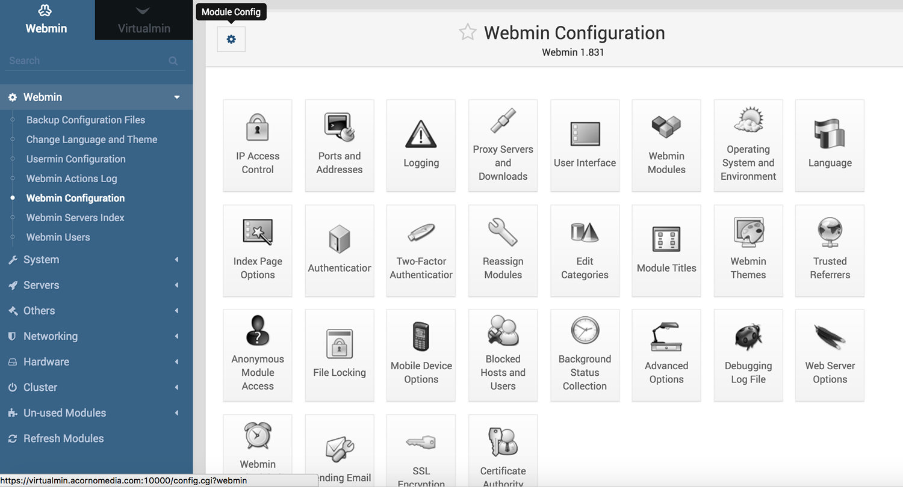
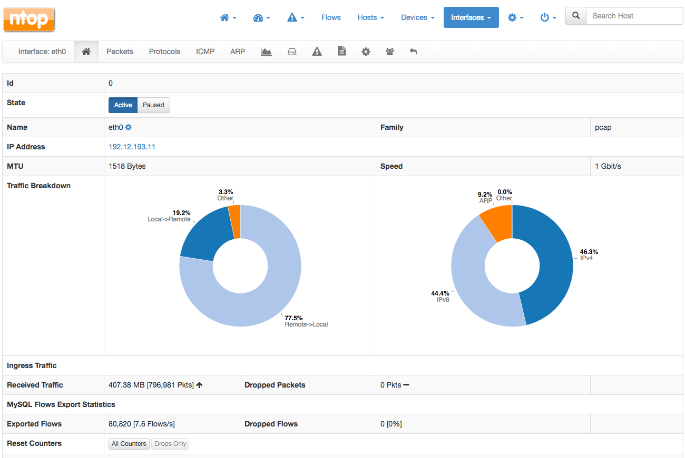

# Administració web

## Introducció

Encara que un servidor no tingui interfície gràfica, existeixen molts **programes** que permeten **configurar un servidor de forma gràfica utilitzant una interfície web** (navegador d'Internet).

Només cal saber com instal·lar-los i fer, si cal, alguna configuració bàsica, i com accedir a través del navegador (en alguns casos es fa a través d'un port específic, en altres cal fer servir _https_, per usar alguns cal tenir instal·lat un servidor de pàgines web com Apache).

## Webmin

**Webmin** és un programa que permet **administrar un servidor** de forma remota a través d'una interfície web gràfica que fa més fàcil la seva configuració.

Entre altres coses, permet administrar els usuaris, els serveis, la instal·lació de paquets i l'actualització del sistema, els sistemes de fitxers locals i remots, RAID i LVM, les quotes de disc, les còpies de seguretat, programar tasques, compartició de carpetes, permisos, configuració de xarxa, tallafocs, monitoratge...

La millor forma d'**instal·lar**-ho és seguir les instruccions de [la seva web](http://www.webmin.com/deb.html) per afegir _**Webmin**_ als repositoris. D'aquesta forma, s'actualitzarà automàticament quan s'actualitzi el sistema.

Per **accedir només cal obrir un navegador** en el client, utilitzar _https_ i posar l'adreça del servidor i el **port 10000**:

`https://IP_servidor:10000`

Possiblement indicarà què s'està accedint a un lloc segur sense certificació reconeguda, però s'ha de permetre l'accés. Finalment, demanarà un usuari administrador (que pugui fer _sudo_) i la seva contrasenya.



## ntop

**Ntop** és un programa que serveix per **monitorar la xarxa**. Ens permet triar quines interfícies es vol monitorar i mostra en gràfics i en taules estadístiques tota la informació de la xarxa. Es pot filtrar en funció dels diversos protocols.

**Ntopng** és la nova generació del **Ntop** original. Aquest programa es troba en els repositoris d'Ubuntu i, per tant, es pot instal·lar amb **apt**.

`sudo apt install ntopng`

Per **accedir a través d'un navegador web** cal escriure l'adreça del servidor i el **port 3000**:

`http://IP_servidor:3000`

L'usuari administrador de **Ntopng** per defecte es diu _**admin**_ i la contrasenya és _**admin**_.

## Nagios

**Nagios** és un sistema de **monitoratge d'equips i serveis de xarxa** que permet tenir un complet control de la disponibilitat de serveis, processos i recursos d'equips.



## Cacti

**Cacti** és una potent **eina de monitoratge** que permet recollir tota mena de dades de l'ordinador: ventiladors, temperatures, utilització de disc i de memòria... i representar-los a través d'una interfície web en forma gràfica amb diferents escales temporals.



Landscape és una plataforma web creada per Canolical (empresa creadora d'Ubuntu) que permet la gestió centralitzada d'equips Ubuntu: escriptoris, servidors, instàncies al núvol, dispositius IoT...&#x20;

Entre altres coses, permet realitzar remotament:&#x20;

* Instal·lació, eliminació i actualització paquets
* Monitoratge en temps real
* Gestió d'altertes
* Gestió d'usuaris
* Execució d'scripts
* Noves instal·lacions desateses d'equips

Funciona amb un model client-servidor amb un servidor central (_Landscape Server_) que allotja la plataforma i un agent (_Landscape Client_) instal·lat a cada equip gestionat de la xarxa.

És un programa directament vinculat a llicènces **Ubuntu Pro**, tot i que disposa d'una versió gratuïta limitada en nombre de clients.



## Documentació i recursos

* **Apunts SOX Pere Sánchez: Administració amb interfície web** [http://moodlecf.sapalomera.cat/apunts/smx/sox/?cap=1.5.15](http://moodlecf.sapalomera.cat/apunts/smx/sox/?cap=1.5.15)
