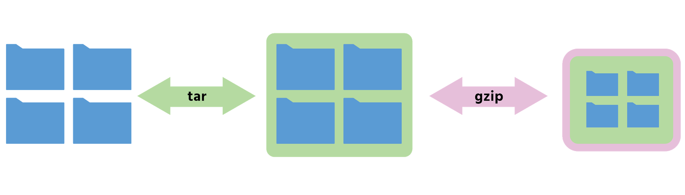

# Gestió d'arxius

## Creació de directoris i fitxers

### Creació de directoris

La comanda `mkdir` (_make directory_) permet crear directoris.

```bash
mkdir [opcions] ruta_al_directori
```

**Exemples de creació de directoris**

#### Exemples d'ús de `mkdir`

| Opcions                  | Exemple                         | Descripció                                                     |
| ------------------------ | ------------------------------- | -------------------------------------------------------------- |
| Sense opcions            | `mkdir directori1`              | Crea el directori `directori1` al directori actual.            |
| Sense opcions            | `mkdir directori1/sotsdir1`     | Crea `sotsdir1` dins `directori1` (si ja existeix).            |
| Sense opcions            | `mkdir dir1 dir2 dir3`          | Crea diversos directoris alhora.                               |
| `-p`, `--parents`        | `mkdir -p /dir1/dir11/dir111`   | Crea tota la ruta de directoris si no existeix.                |
| `-m mode`, `--mode=mode` | `mkdir -m 755 /dirA`            | Crea el directori amb els permisos especificats.               |
| Comodins                 | `mkdir direct{A..E}`            | Crea `directA`, `directB`, `directC`, `directD` i `directE`.   |
| Comodins                 | `mkdir -p sa{a,c,g}/sax{1..50}` | Crea `saa`, `sac` i `sag`, amb subdirectoris `sax1` a `sax50`. |

> **Important:** Si algun dels directoris de la ruta no existeix i no utilitzes `-p`, la comanda retornarà un error.

### Creació de fitxers

#### Comanda `touch`

La comanda `touch` permet crear fitxers buits o actualitzar-ne les marques temporals.

```bash
touch [opcions] ruta_al_fitxer
```

**Exemples d'ús**

| Opcions             | Exemple                     | Descripció                                 |
| ------------------- | --------------------------- | ------------------------------------------ |
| Sense opcions       | `touch fitxer1`             | Crea el fitxer `fitxer1`.                  |
| Sense opcions       | `touch directori1/fitxer11` | Crea el fitxer dins del directori indicat. |
| Sense opcions       | `touch fitxerA fitxerB`     | Crea diversos fitxers simultàniament.      |
| `-c`, `--no-create` | `touch -c fitxerV`          | No crea el fitxer si no existeix.          |
| Comodins            | `touch fitx{A..D}`          | Crea els fitxers `fitxA` a `fitxD`.        |
| Comodins            | `touch {a,d,l2}post`        | Crea `apost`, `dpost` i `l2post`.          |
| Comodins            | `touch fitx{A..E}`          | Crea els fitxers `fitxA` a `fitxE`.        |

#### Altres formes de crear fitxers

**Amb un editor de text**

```bash
nano arxiu.txt
```

**Mitjançant redirecció**

```bash
echo "Exemple de text" > arxiu.txt
```

* `>` crea o sobreescriu el contingut del fitxer.
* `>>` afegeix contingut al final del fitxer.

## Eliminació de fitxers i directoris

### Comanda `rmdir`

La comanda `rmdir` permet eliminar directoris buits.

```bash
rmdir [opcions] ruta_al_directori
```

**Exemples d'ús**

| Opcions       | Exemple                  | Descripció                                                     |
| ------------- | ------------------------ | -------------------------------------------------------------- |
| Sense opcions | `rmdir directori1`       | Elimina un directori buit.                                     |
| Sense opcions | `rmdir dir1 dir2`        | Elimina diversos directoris buits.                             |
| Sense opcions | `rmdir *`                | Elimina tots els directoris buits del directori actual.        |
| `-p`          | `rmdir -p dir1/sotsdir1` | Elimina el directori indicat i els seus pares si queden buits. |

> **Important:** `rmdir` només elimina directoris buits.

### Comanda `rm`

La comanda `rm` (_remove_) permet eliminar fitxers i directoris.

```bash
rm [opcions] ruta_al_fitxer
```

**Exemples d'ús**

| Opcions                   | Exemple                 | Descripció                                   |
| ------------------------- | ----------------------- | -------------------------------------------- |
| Sense opcions             | `rm fitxer1`            | Elimina un fitxer.                           |
| Sense opcions             | `rm fitxerA fitxerB`    | Elimina diversos fitxers.                    |
| `-f`, `--force`           | `rm -f fitxerA fitxerB` | Força l'eliminació sense confirmació.        |
| `-i`                      | `rm -i *`               | Demana confirmació abans d'eliminar.         |
| `-r`, `-R`, `--recursive` | `rm -r directori1`      | Elimina un directori i tot el seu contingut. |
| `-d`, `--dir`             | `rm -d dirA`            | Elimina un directori buit.                   |

> ⚠️ Utilitza `rm -r` amb molta precaució, ja que elimina el contingut de forma recursiva.

## Còpia i moviment de fitxers i directoris

### Comanda `cp`

La comanda `cp` (_copy_) permet copiar fitxers i directoris.

```bash
cp [opcions] origen desti
```

**Exemples d'ús**

| Opcions       | Exemple                              | Descripció                                 |
| ------------- | ------------------------------------ | ------------------------------------------ |
| Sense opcions | `cp fitxer1 ../`                     | Copia el fitxer al directori superior.     |
| `-r`, `-R`    | `cp -r directori1 carpeta_de_desti/` | Copia un directori i tot el seu contingut. |
| `-i`          | `cp -i text1.txt carpeta_de_desti/`  | Demana confirmació abans de sobreescriure. |

**Altres exemples**

```bash
cp text.txt /home/usuari/carpeta_de_desti/
```

```bash
cp text1.txt text2.txt text3.txt /home/usuari/carpeta_de_desti/
```

```bash
cp text.txt /home/usuari/carpeta_de_desti/text3.txt
```

```bash
cp text.txt text2.txt
```

### Comanda `mv`

La comanda `mv` (_move_) permet moure fitxers o directoris.

```bash
mv [opcions] origen desti
```

**Exemples d'ús**

| Opcions       | Exemple                                           | Descripció                                 |
| ------------- | ------------------------------------------------- | ------------------------------------------ |
| Sense opcions | `mv fitxer1 ../`                                  | Mou el fitxer al directori superior.       |
| `-f`          | `mv -f directori1 /home/usuari/carpeta_de_desti/` | Sobreescriu sense demanar confirmació.     |
| `-i`          | `mv -i text1.txt /home/usuari/carpeta_de_desti/`  | Demana confirmació abans de sobreescriure. |

**Altres exemples**

```bash
mv text.txt /home/usuari/carpeta_de_desti/
```

```bash
mv /home/usuari/carpeta_origen/text.txt /home/usuari/carpeta_de_desti/
```

```bash
mv *.txt /home/usuari/carpeta_de_desti/
```

```bash
mv text.txt text2.txt
```

## Reanomenar fitxers i directoris

### Reanomenar amb `mv`

En GNU/Linux normalment es fa servir la comanda `mv` per canviar el nom d'un fitxer o directori.

```bash
mv nom_original nom_nou
```

**Exemples**

```bash
mv text1.txt text2.txt
```

```bash
mv text1.txt directori12/text2.txt
```

```bash
mv directori directori_nou
```

### Comanda `rename`

La comanda `rename` permet reanomenar múltiples fitxers mitjançant expressions regulars.

```bash
rename [opcions] perlexpr fitxers
```

**Canviar una extensió**

```bash
rename 's/\.jpeg$/.jpg/' *
```

**Convertir majúscules en minúscules**

```bash
rename 'y/A-Z/a-z/' *
```

> La comanda `rename` no està instal·lada per defecte en totes les distribucions Linux.

## Comprimir i descomprimir

### Comandes zip i unzip

> Les comandes **zip** i **unzip** permeten comprimir i descomprimir **varis arxius o directoris**.

El nom de l'arxiu comprimit és el mateix que el de l'arxiu original però afegint l'extensió **.zip**.

**ZIP** és la forma de compressió més popular en Windows.


**Paràmetres:**

* `-r` per comprimir de forma recursiva (directoris).

**Per comprimir tot un directori:**

`zip -r arxiu_comprimit.zip directori`

**Per descomprimir:**

`unzip arxiu_comprimit.zip`

### Comandes gzip i gunzip

> Les comandes **gzip** i **gunzip** serveixen per comprimir/descomprimir **un únic arxiu**.

**GZIP** és el sistema de compressió estàndard en Linux.

El nom de l'arxiu comprimit és el mateix que el de l'arxiu original però afegint l'extensió **.gz**.

Si volem **comprimir més d'un arxiu** en un sol arxiu `.gz` necessitarem l'ajuda d'una altre comanda com per exemple `tar`.


**Paràmetres:**

* `-c` manté l'arxiu original (evita que s'elimini automàticament)
* `-r` per comprimir de forma recursiva (directoris).

**Per comprimir un arxiu:**

`gzip -c document`

**Per descomprimir un arxiu:**

`gunzip -c document.gz`

## Empaquetar i desempaquetar

### Comanda tar

La comanda **tar** serveix per empaquetar/desempaquetar un conjunt d'arxius (sense comprimir-los).


**Opcions d'empaquetat:**

* `-c` crear arxiu empaquetat (si existeix, primer l'esborra).
* `-x` o `--extract` desempaquetar arxiu.
* `-f` indica la ruta al fitxer creat (tar).
* `-v` _verbose_ (mostra els arxius comprimits o descomprimits).

**Empaquetar i desempaquetar un directori**:

```
tar -cvf documents.tar ./documents/
tar -xvf documents.tar
```

Si a més es vol **comprimir/descomprimir** utilitzant el format **.gz** cal afegir el paràmetre **z**.

**Opcions de compressió:**

* `-z` comprimir / descomprimir amb algoritme gzip.



Per **comprimir tot un directori**:

`tar -zcfv arxiu_comprimit.tar.gz directori`

Per **descomprimir**:

`tar -xfv arxiu_comprimit.tar.gz`

## Documentació i altres recursos

* **Apunts SOX Pere Sánchez:** [Edició d'arxius](http://moodlecf.sapalomera.cat/apunts/smx/sox/index.html?ref=2221)
* **Apunts SOX Pere Sánchez:** [Gestió d'arxius](http://moodlecf.sapalomera.cat/apunts/smx/sox/index.html?ref=2222)
* **Apunts SOX Pere Sánchez:** [Gestió de carpetes](http://moodlecf.sapalomera.cat/apunts/smx/sox/index.html?ref=2223)
