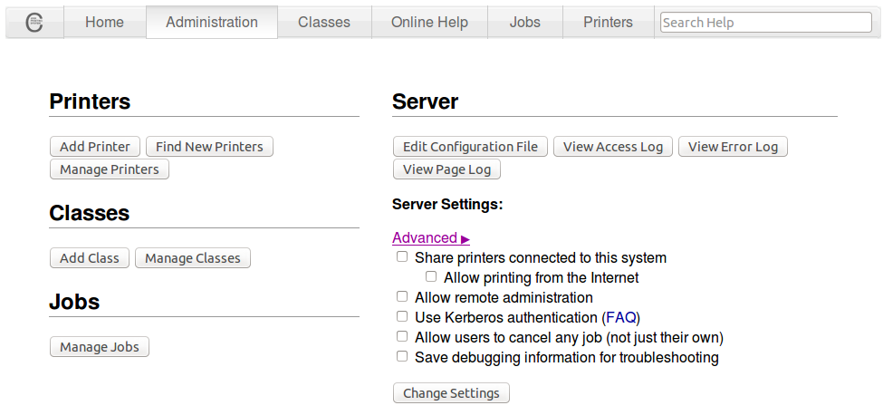

# Compartir impressores amb CUPS

## Servei d'impressió a GNU/Linux

En els sistemes Unix i Linux han existit històricament dos principals estàndards d’impressió: el sistema **System V** i el sistema **BSD**. Actualment, però, la gran majoria de distribucions Linux utilitzen el sistema d’impressió **CUPS (Common Unix Printing System)**, que és compatible amb moltes de les ordres dels sistemes anteriors.

Sigui quin sigui el sistema utilitzat, el principi de funcionament és similar. A cada impressora configurada li correspon una **cua d’impressió (print queue)**. Un servei del sistema s’encarrega de gestionar aquestes cues. Aquest mecanisme permet la **impressió multiusuari**, ja que diversos usuaris poden enviar treballs d’impressió que s’emmagatzemen en una cua (job queue) i s’imprimeixen de manera ordenada. També permet la **impressió en xarxa**, de manera que diferents ordinadors poden utilitzar la mateixa impressora.

En els sistemes moderns basats en CUPS, la configuració de les impressores es guarda habitualment dins del directori `/etc/cups/`, i també es pot administrar mitjançant una interfície web.

Moltes impressores poden imprimir directament text pla ASCII. Tanmateix, per imprimir documents amb format, gràfics o imatges, el sistema utilitza **filtres d’impressió**. Aquests filtres són programes o scripts que reben el document d’entrada (text, imatge, PDF, PostScript...), l’identifiquen i el transformen en un llenguatge que la impressora pot entendre, com ara **PostScript** o **PCL**.

En els sistemes Linux moderns també s’utilitza sovint la **impressió sense drivers (driverless printing)**, basada en protocols estàndard com **IPP (Internet Printing Protocol)**. Aquest sistema permet que moltes impressores funcionin sense necessitat d’instal·lar controladors específics.

Per comprovar la compatibilitat d’una impressora amb Linux, es pot consultar la base de dades del projecte **OpenPrinting**, que manté informació actualitzada sobre el suport d’impressores en sistemes Linux.

## Servei d'impressió CUPS

**CUPS** _**(common Unix printing system)**_ eina que ens proporciona un sistema d’impressió que ens permet **centralitzar, compartir i gestionar impressores** instal·lades en una màquina que fa les tasques de servidor d’impressió.

Permet que un ordinador actuï com a **servidor d’impressió**.

CUPS s’encarrega de gestionar els **treballs d’impressió** i les seves **cues d’espera**, i permet la impressió tant local com en xarxa. Per fer-ho utilitza principalment el protocol estàndard **Internet Printing Protocol (IPP)**, que permet enviar treballs d’impressió a través de la xarxa.

La gran majoria de distribucions GNU/Linux utilitzen el CUPS com a sistema d’impressió per defecte.

Quan el **CUPS** es fa servir amb el **Samba**, les impressores també es poden utilitzar en ordinadors **Windows** remots per imprimir per mitjà de la xarxa.


CUPS també permet configurar i administrar les impressores mitjançant una **interfície web**, accessible habitualment des del navegador a l’adreça:

```
http://localhost:631
```

### Controladors i compatibilitat d’impressores

Tradicionalment, CUPS utilitzava fitxers **PPD (PostScript Printer Description)** per descriure les característiques de cada impressora i instal·lar els controladors corresponents.

Actualment, molts sistemes utilitzen el que s’anomena **impressió sense drivers (driverless printing)**, que permet utilitzar impressores modernes sense instal·lar controladors específics. Aquesta tecnologia es basa en estàndards com:

* **IPP Everywhere**
* AirPrint
* Mopria

Tot i així, CUPS continua mantenint compatibilitat amb els fitxers **PPD** per suportar impressores més antigues.

La detecció automàtica d’impressores en xarxa es realitza normalment mitjançant protocols com **mDNS / DNS-SD**, que permeten descobrir dispositius disponibles a la xarxa local.

### Característiques principals de CUPS

Les característiques principals del sistema CUPS són:

* Basat en el protocol **IPP**, que utilitza el protocol **HTTP/1.1** per comunicar-se amb les impressores i servidors d’impressió.
* Administració centralitzada mitjançant una **interfície web** accessible des del navegador a través de l'adreça `http://localhost:631`.
* Sistema de conversió de documents mitjançant filtres basats en **tipus MIME**, que transformen els documents al format que entén la impressora.
* Compatibilitat amb les ordres d’impressió dels sistemes **System V** i **BSD**, com ara:
  * `lp`, `cancel` (System V)
  * `lpr`, `lpq`, `lprm` (BSD)
* Registre de l’activitat d’impressió mitjançant fitxers de **logs**, en un format semblant al dels servidors web.
* Compatibilitat amb servidors d’impressió antics basats en el protocol **LPD**, per mantenir la interoperabilitat amb sistemes més antics.

CUPS també ofereix altres funcionalitats avançades:

* **API pròpia**, que permet als desenvolupadors crear aplicacions o interfícies gràfiques per gestionar la impressió.
* Possibilitat de crear **grups d’impressores (printer pooling)**, que permeten distribuir automàticament els treballs entre diverses impressores sota un mateix nom.
* Sistemes d’**autenticació i control d’accés**, que poden limitar qui pot utilitzar una impressora segons l’usuari, la màquina o altres criteris.

### Servei i registres del sistema

El servei principal del sistema d’impressió de CUPS és el dimoni **cupsd**.

Per detectar possibles problemes amb el servei d’impressió, es poden consultar els **fitxers de registre**, que habitualment es troben a `/var/log/cups/error_log`

### Administració del sistema d’impressió

Per administrar les impressores mitjançant línia d’ordres o interfície web, l’usuari ha de tenir permisos d’administració del sistema d’impressió.

En moltes distribucions Linux, com Ubuntu, això implica formar part del grup **lpadmin**.

Els usuaris d’aquest grup poden afegir, eliminar o modificar impressores i cues d’impressió.

### Llistat de carpetes de CUPS

Alguns directoris importants relacionats amb el servei son:

* **/etc/cups/**: És el directori principal de CUPS.
* **/var/spool/cups/**: Conté els fitxers temporals de les cues d’impressió. Cada treball d’impressió passa per aquí.
* **/var/log/cups/**: Carpeta amb logs del servidor: errors, accessos i historial d’impressió.
* **/etc/cups/ppd/:** Aquest directori conté fitxers .ppd (PostScript Printer Description) per a cada impressora instal·lada. Aquests fitxers descriuen totes les funcionalitats de la impressora (impressió a doble cara, resolució, safates de paper, etc.).

### Llistat de fitxers de CUPS

Com tots els serveis, CUPS es desgrana en diversos fitxers. Els més importants son:

* **/etc/cups/cupsd.conf**: És el fitxer principal. Defineix com es comporta el servei (el dimoni cupsd): qui té permís per imprimir, si s'accepten connexions remotes, les directives (permisos específics, el nivell de registre d'errors (logs) i els mètodes d'autenticació.
* **/etc/cups/cups-files.conf**: Defineix carpetes de CUPS, propietaris i permisos d’accés: on es guarden les cues d’impressió, fitxers temporals i PDFs.
* **/etc/cups/printers.conf**: Aquí es llisten totes les impressores instal·lades. Guarda informació sobre l'estat de la impressora, el nom del dispositiu, la URL de connexió (URI) i si està compartida o no. <mark style="color:$danger;">**Compte!**</mark> <mark style="color:$danger;">No editar a mà aquest fitxer.</mark>

A més, amb les impressores intal·lades es crea un fitxer amb l'accés a la configuració del **driver**. En el cas de la impressora **cups-pdf** és _`/etc/cups/cups-pdf.conf`_

### Instal·lació del servei d'impressió CUPS

La instal·lació de **CUPS** en Ubuntu no és necessaria perquè ja ve instal·lat per defecte.

El paquet **cups** instal·la el servidor d'impressió CUPS que permet instal·lar, configurar i compartir impressores en xarxa.

Es podria instal·lar amb la comanda:

```
sudo apt install cups
```

### Administrar el servidor d'impressió CUPS

Per poder configurar i administrar el servidor CUPS disposes de:

* **comandes** de l’intèrpret d’ordres
* **una interfície web** que funciona sobre el port 631.

La interfície web permet afegir, cercar i eliminar impressores i controlar els treballs en les cues d’impressió.

### Permetre la configuració remota a través de la interfície web

La interfície web per l'**administració remota** de CUPS està per defecte deshabilitada.

Per permetre l'accés remot utilitzarem la comanda `cupsctl`.\
amb el paràmebre `--remote-admin` que habilita l'accés remot però només des de la xarxa local

```
sudo cupsctl --remote-admin
sudo systemctl restart cups
```

### Configurar CUPS de forma remota a través d'una interfície web

Per accedir de forma remota a la web de configuració del servidor d'impressió, només cal obrir un navegador web i posar l'adreça:

> `https://172.30.A.20:631`

On `172.30.A.20` és la IP del servidor d'impressió.


Si no podem accedir, es pot afegir al fitxer _**/etc/cups/cupsd.conf**_ la següent línia **`Listen IP_servidor:631`**

Per exemple, per si el servidor té la IP 192.168.2.1 posariem:

`Listen 192.168.2.1:631`


Si demana un **usuari** i contrasenya per canviar alguna configuració, es pot utilitzar qualsevol usuari que pertanyi al grup _**lpadmin**_, per exemple l'usuari principal.

Si no hi ha cap usuari que pertanyi a aquest grup, es pot afegir un usuari a aquest grup amb les següents comandes:

```bash
sudo usermod -aG lpadmin usuari
sudo systemctl restart cups
```

#### Permisos d'accés a la interfície web

Editem l'arxiu **/etc/cups/cupsd.conf** que és on tenim les directives dels permisos, cada\
part correspon a una secció de la interfície de administració.

Les següents opcions es poden fer servir per:

1. Restricció a l'**accés al servidor** (secció: _Restrict access to the server..._) és la política _\<Location />_
2. Restricció a les **pàgines d'administració** (secció: _Restrict access to admin pages..._) és la política _\<Location /admin>_

Podem fer-ho directament o a través de la interfície web “_Administración > Servidor > Editar archivo configuración_”:

* Per habilitar-lo en **mode local** escrivim aquesta configuració:


```
...
<Location />
    Order allow,deny
    Allow from 127.0.0.1
    Allow from localhost
</Location>
...
```


* Per habilitar-lo en per una **IP concreta** (_192.168.2.2_) es pot incloure aquesta línia a la configuració:


```
...
<Location />
    Order allow,deny
    Allow from 192.168.2.2
</Location>
...
```


* Per habilitar-lo a una **xarxa concreta** (_192.168.2.0/24_) es pot incloure aquesta línia a la configuració:


```
...
<Location />
    Order allow,deny
    Allow from 127.0.0.1
    Allow from 192.168.2.*/24
</Location>
...
```


* Per habilitar-lo per **qualsevol** **xarxa local** es pot incloure aquesta línia a la configuració:


```vim
...
<Location />
    Order allow,deny
    Allow from 127.0.0.1
    Allow from @LOCAL
</Location>
...
```


* **Restringuir l'accés** a un usuari o grup. Per exemple, en el següent cas es donarà accés a l'usuari _watson_ i el grup _investigadors_ a tota la web.


```vim
...
#Restric access to the server...
<Location />
    Require user watson @investigadors
    Order allow,deny
    Allow from 127.0.0.1
</Location>
...
```


Després de cada canvi caldrà reiniciar el servei:

`sudo systemctl restart cups`

## Instal·lació de la impressora CUPS-PDF en xarxa

El paquet **cups-pdf** ens instal·la una impressora virtual que permet crear fitxers PDF. Quan s'envia un document a aquesta impressora, enlloc d'imprimir-se, es converteix a PDF i es guarda en una carpeta predeterminada.

És similar al PDFCreator de Windows.

`sudo apt install cups-pdf`

### Afegir la impressora CUPS-PDF en el servidor CUPS

Per instal·lar una impressora en el servidor CUPS hem de seleccionar l’opció **Add printer** de la pestanya **Administration**.



1. Seleccionem la impressora a instal·lar. Per exemple l’impressora local **CUPS-PDF (Virtual PDF Printer)**.
2. Cal posar un nom a la impressora, i si es vol, una descripció i lloc on es troba la impressora.
   * També cal marcar l’opció de **“Share This Printer”** per compartir-la.
3. Ens demanarà el **fabricant** de la impressora. Seleccionem la marca **Generic** (també poden ser **CUPS-PDF** o **Virtual PDF Printer**)
4. Seguidament, ens demanarà pel **model d'impressora** per instal·lar els controladors més adequats.
   * També, permet especificar aquests controladors mitjançant un fitxer de text en format PPD (PostScript printer description).
   * Seleccionem el model **Generic CUPS-PDF Printer (en)** o **Generic PDF Printer**, o **Generic PostScript Printer** (dels que estiguin marcat com _recomenats_). Una altra opció moderna: **Everywhere** (que no necessiten la instal·lació de drivers específics).
5. Si s’instal·la correctament, apareixerà una pantalla que ens permetrà configurar les **opcions generals d’impressió** de la impressora.
6. Amb això ja tenim la impressora configurada.

#### <mark style="color:orange;">**Alternativa**</mark>

Si no es pot afegir, **CUPS-PDF** no crea automàticament la impressora fins que **s’ha afegit correctament amb lpadmin**. Per Ubuntu recent:

```bash
sudo lpadmin -p PDF -E -v cups-pdf:/ -m everywhere
sudo cupsenable PDF
sudo cupsaccept PDF
```

* `sudo lpadmin -p PDF -E -v cups-pdf:/ -m everywhere` -> Crea la impressora virtual PDF amb nom PDF. Una alternativa és optar per `-m raw`, però aquesta hauria deixarà d'estar operativa en el futur.
* `sudo cupsenable PDF` -> Activa la impressora
* `cupsaccept PDF-Test` -> Permet enviar treballs a la impressora

Per comprovar si està activa:

`lpstat -p`

Una resposta seria quelcom semblant a:

```bash
$ lpstat -p
la impresora PDF está inactiva.  activada desde ...
```

### Configuració del directori on s'envien els documents PDF

La configuració es troba a l'arxiu `/etc/cups/cups-pdf.conf`, en el paràmetre **Out**.

En el cas d'Ubuntu, envia els documents a una carpeta anomenada **PDF**, dins del directori personal de l'usuari que ha imprès el document (el valor **${HOME}** equival a `/home/usuari`):

`Out ${HOME}/PDF`

Per motius de seguretat, el programa CUPS només pot escriure en algunes carpetes, i això ho determina la configuració del programa **apparmor**.

### Configuració d'un directori comú on s'envien els documents PDF

Si es vol que tots els document de la impressora **cups-pdf** vagin a una carpeta comuna, per exemple a `/svr/documents/pdf`, primer s'ha de crear la carpeta on s'han d'enviar els documents generats per la impressora **cups-pdf**, i donar-li permisos de lectura i escriptura per a tothom.

```
sudo mkdir -p /srv/documents/pdf
sudo chmod 777 /srv/documents/pdf
```

Després, en l'arxiu `/etc/cups/cups-pdf.conf`, posar en el paràmetre **Out** el nou directori.

`Out /srv/documents/pdf`

I reiniciar el servei cups:

```
sudo systemctl reload cups
```

Finalment s'ha d'afegir aquest directori a la llista de directoris on pot escriure el programa CUPS.\
Això es fa en l'arxiu `/etc/apparmor.d/usr.sbin.cupsd`.

Es pot afegir la línia a continuació de les que configuren els directoris personals.

```
@{HOME}/PDF/ rw,
/srv/documents/pdf/* rw,
```

I reiniciar el servei **apparmor**:

```
sudo systemctl reload apparmor
```

## Verificacions

### Comprovar l'estat del servei CUPS

A un terminal executar:

`systemctl status cups`

* **Si funciona:** Sortirà un missatge que diu _**active (running)**_.
* **Si està parat:** Es pot reactivar amb la comanda: `sudo systemctl start cups`.

Per comprova si el servei està en execució també es pot fer amb la comanda `lpstat`

`lpstat -r`

### Comprovar que els servei CUPS escolta pel port

Per comprovar directament que CUPS escolta perl port **631**, es pot fer servir:

* `ss -tulpn | grep 631` per veure l'estat del port.
* `nmap localhost -p 631` per comprovar si està obert el port.

### Comprovar que la impressora existeix

Per revisar les impressores, l'estat de la cua i del servidor, es pot fer servir la comanda `lpstat`.

* `lpstat -p`: Per llistar les impressores, i comprovar si està **preparada** o si té algun error.
* `lpstat -a` : Per veure si la impressora **accepta** treballs i es pot fer servir.
* `lpstat -t`: Mostra tota la informació de les impressores.

### Veure si la impressora està compartida

Per revisar una impressora en concret s'ha de fer servir el nom donat a la impressora i executar la següent comanda:

` lpstat -l -p`` `` `_`NomImpressora`_

Ha d’indicar que està **enabled** i compartida.

També es pot fer servir de la mateixa comanda:

`lpstat -a`

o

`lpstat -e` que llista tots els mons de els impressores disponibles al sistema i la xarxa local.

Una altra comanda és `lpinfo` una eina de "descobriment".:

`lpinfo -v` ens permet veure quins dispositius estan disponibles, tant locals com en xarxa local.

### Veure els treballs d’impressió

Es poden fer servir dues comandes:

* `lpstat -o`: Llista tots els treballs d'impressió pendents (la cua) amb un identificador.
* `lpstat -u [usuari]`: Filtra la cua per veure només els treballs de l'usuari indicat.

## Instal·lació en el client d'una impressora compartida

### Afegir impressora gràficament

1. Per tal que el **client** utilitzi les impressores remotes instal·lades en el servidor CUPS, des de l’Ubuntu, anirem al menú **Sistema > Administració > Impressores**.
2. En aquesta pantalla haurem de seleccionar la icona **Afegeix > Impressora** i començarà un procés de cerca de les impressores que detecti l’equip.
3. Al final d’aquest procés se’ns obrirà el quadre Impressora nova
   * Si ens ha detectat la impressora que volem instal·lar, només caldrà que premem el botó Endavant.
   * Si no ens ha detectat la impressora, despleguem l'opció **Impresora de red** i triem **Buscar impressora de red**. En el camp **Equip** posem la IP del servidor on està compartida i cliquem **Buscar**.
4. Ens demanarà el nom mitjançant el qual volem que es reconegui la impressora en el sistema i haurem de fer clic a **Aplica**.
   * De manera opcional, també ens demanarà una descripció d’aquesta impressora i lloc on es troba.
5. Finalment, el sistema ens proposarà **imprimir una pàgina de prova** perquè puguem estar segurs que la instal·lació s’ha fet correctament.

### Afegir impressora per terminal

**1. Cercar l'adreça de la impressora (URI)**

Primer hem de saber com es diu la impressora a la xarxa. Executa això al Client:

```bash
lpstat -e
```

Això t'hauria de llistar les impressores disponibles. Cercar la impressora amb el nom configurat al servidor.

Si no surt res, prova de buscar-la per xarxa:

`/usr/sbin/lpinfo -v`

Cerca la línia que comenci per _dnssd://..._ o _ipp://\[IP-DEL-SERVIDOR]...._

**2. Afegeix-la per comanda**

Amb la IP del servidor, es pots forçar la creació al client amb aquesta sintaxi:

```bash
sudo lpadmin -p PDF_Xarxa -E -v ipp://172.30.A.20:631/printers/PDF -m everywhere
```

On:

* **-p PDF\_Xarxa**: El nom que tu vulguis posar-li localment.
* **-E**: Activa la impressora immediatament.
* **-v**: L'adreça (URI) que hem trobat abans.
* **-m** everywhere: Fa servir el controlador genèric IPP Everywhere (estàndard actual).
