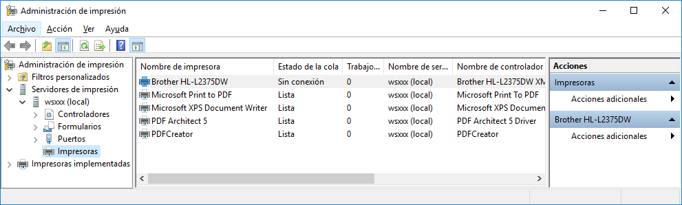
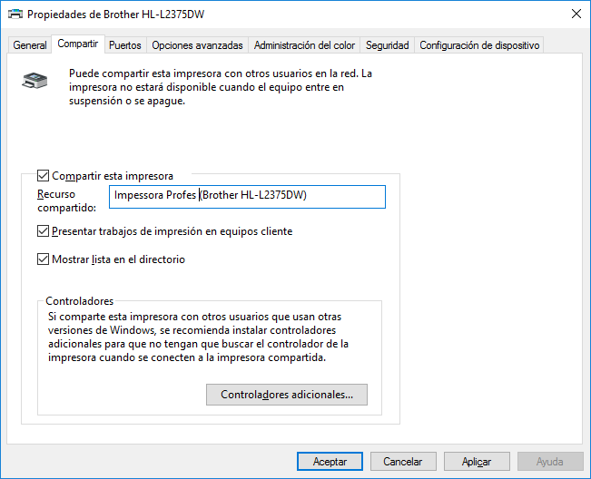
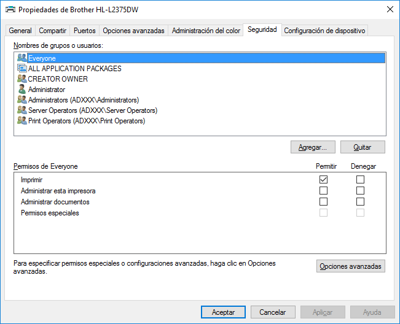
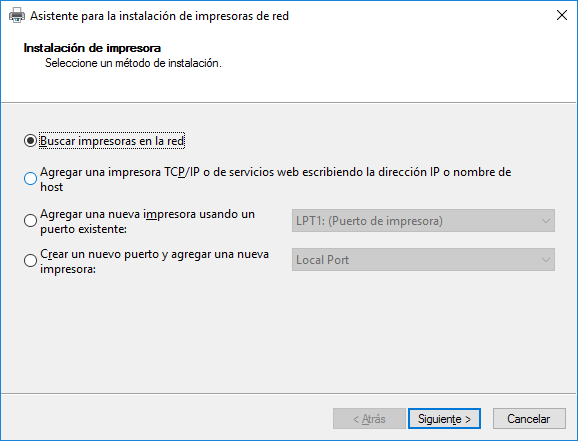
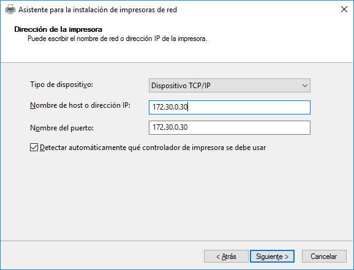

# Compartir impressores en Windows

## Instal·lar el rol Servei d'impressió (a un Windows Server)

> El protocol que utilitza Windows (**SMB/CIFS**) ja ve implementat en el sistema, encara que no sigui un Windows Server, i per tant no cal instal·lar res per poder-lo utilitzar.

Si es disposa d'un servidor, i sobretot si es disposa d'un domini, el més recomanable és instal·lar el **Servei d'impressió (**_**Print Server**_**)**, que amplia les possibilitats d'administració de les impressores compartides.

Aquest servei s’encarregarà de compartir les impressores dins una xarxa i **gestionar la cua d’impressió** on es guarden de forma ordena els documents que rep per imprimir. Fins i tot, permet **instal·lar impressores automàticament** en els clients a través de directives.

Per instal·lar el **Servidor d'impressió** en el servidor, cal afegir el rol de **Serveis d’Impressió** seguint els següents passos:

1. Anem a l’_**Administrador del Servidor**_.
2. Afegir rols i característiques i afegim el rol _**Serveis d'impressió i documents (Print and Document Services)**_.
3. Seleccionem únicament el servei de rol _**Servidor d'impressió (Print Server)**_.
4. I fem instal·lar.

## Compartir la impressora

Tant en Windows Server com en Windows (client), es pot fer servir l'eina de Configuració de Windows, podem accedir gestionar les impressores i accedir a les aplicacions associades mitjançant: _**Configuració > Bluetooth y dispostivos > Impresoras y escáneres**_.

En els sistemes Windows empresarials tenim _**Administrador del Servidor**_, podem obrir l'administrador d'impressió anant a _**Eines > Administrador d'impressió**_.

En el panell esquerre, dins la categoria de _**Serveis d'impressió**_ trobem:

* Controladors \[_Drivers_]
* Formularis \[_Forms_]
* Ports \[_Ports_]
* Impressores \[_Printers_]

### Controladors

> Si la impressora està correctament instal·lada i configurada de forma local en el servidor, ja disposarem dels controladors necessaris per imprimir localment.

Així i tot, és interessant **guardar controlador pels diferents sistemes operatius** que utilitzen els equips clients del nostre domini. Així quan s'instal·li la impressora en el client ja tindrà disponible els controladors necessaris i no ens sol·licitarà el disc de la impressora.

Podem afegir un nou controlador fent _**Botó dret de ratolí > Afegir controlador...**_

### Impressores

Per compartir una impressora cal anar l'_**Administració d'impressió**_, seleccionar una impressora i anar a _**Administrar ús compartit**_ o bé a les _**propietats de la impressora**_ i entrar a la pestanya _**Compartir**_.

* Marquem l'opció _**Compartir aquesta impressora**_
* **Nom del recurs compartit**: nom amb què es veurà la impressora a la xarxa.
* Marquem l'opció _**Presentar treballs d'impressió en els equips clients**_.
* Marquem l'opció _**Mostrar llista en el directori**_.

Si compartim aquesta impressora amb usuaris que tinguin altres versions de Windows, cal fer ús del botó _**Controladors addicionals...**_ que ens permet instal·lar controladors per altres versions de Windows i així no l'hauran de buscar a l'instal·lar la impressora.

## Gestió de permisos de compartició

La pestanya _**Seguretat**_ s'accedeix a les opcions per configurar els permisos de compartició de la impressora. No es gestionen els permisos a la pestanya _Compartir_.

> Cal treure el grup _**Tots \[Everyone]**_ per tal que només puguin utilitzar la impressora els usuaris que indiquem a continuació.

### Gestionar els usuaris

Es poden afegir o eliminar usuaris i grups fent clic al botó _**Agregar…**_

### Gestionar els permisos simples

Seleccionant l'usuari o grup es poden marcar o desmarcar les caselles _**Permitir**_ o _**Denegar**_ en cada permís.

Per defecte, si no està marcada la casella _**Permitir**_, implica que no es té el permís corresponent.

Els **permisos** que es poden assignar són:

* _Imprimir_
* _Administrar aquesta impressora_
* _Administrar documents_&#x20;
* _Permisos especials_

### Opcions avançades

Amb el botó _**Opciones avanzadas**_ es poden canviar algunes propietats avançades com:

* Canviar el propietari.
* Assignar _**Permisos especials**_ com:&#x20;
  * _Permisos de lectura_&#x20;
  * _Canviar permisos_ &#x20;
  * _Prendre possessió_
* Veure els permisos efectius.

## Instal·lar la impressora compartida en el client

S'han de seguir les instruccions del fabricant de la impressora.

## Implementar impressora compartida amb directiva de grup

La implementació d’impressores amb GPO (Group Policy Object) és una tècnica utilitzada en entorns Windows per assignar, publicar o connectar impressores de xarxa de manera centralitzada i automatitzada, segons unitats organitzatives (OU), grups d’usuaris o ubicació.

Enllaços a tutorials:

* [Instalando Impresoras por Directivas de Grupo (GPOs)](https://windowserver.wordpress.com/2015/12/15/instalando-impresoras-por-directivas-de-grupo-gpos/)
* [Microsoft Learn - Usar la configuración de directiva de grupo para controlar las impresoras en Active Directory](https://learn.microsoft.com/es-es/troubleshoot/windows-server/printing/use-group-policy-to-control-ad-printer)

## Instal·lar impressora de xarxa

Obrir l'_**Administrador d'impressió**_ anant a _**Eines > Administrador d'impressió**_, fer botó dret del ratolí i escollir _**Afegir impressora...**_ >

Podem instal·lar una impressora de xarxa varies formes en funció de si coneixem la IP o nom de la impressora o sinó tenim cap informació.

*   Opció _**Buscar impressores a la xarxa:**_ Si no sabem la IP o nom de la impressora.

    A continuació ens ha de detectar la impressora compartida i la seleccionem de la llista.
*   Opció _**Afegir impressora TCP/IP escrivint la direcció IP o nom de host**_

    A continuació caldrà posar la IP o nom de la impressora &#x20;

### Instal·lar controlador

## Documentació i recursos

* **Somebooks**: Compartir una impresora del controlador de dominio con Windows Server 2016 ([http://somebooks.es/compartir-una-impresora-del-controlador-dominio-windows-server-2016/](http://somebooks.es/compartir-una-impresora-del-controlador-dominio-windows-server-2016/))
